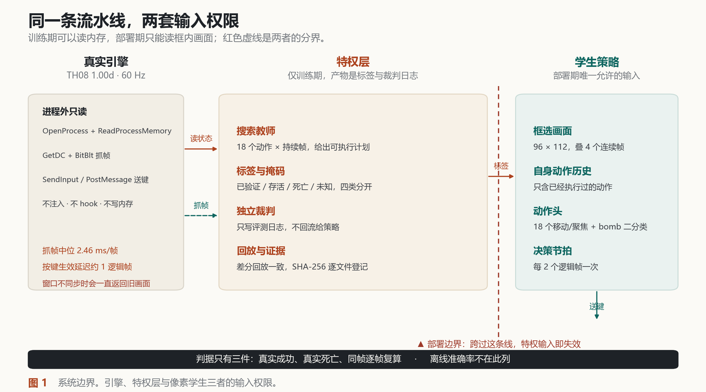
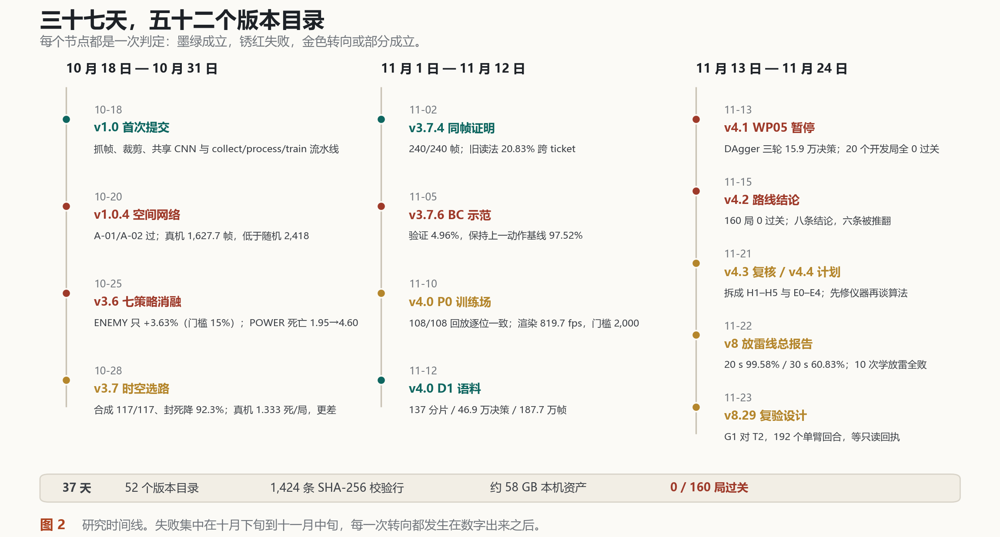
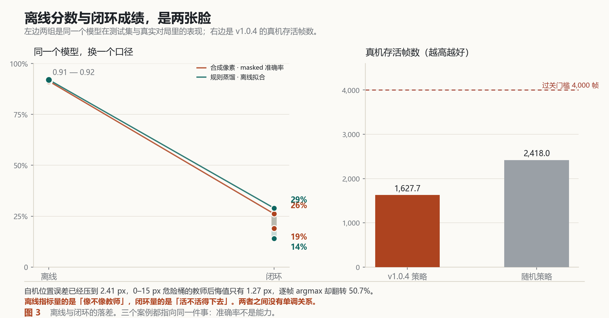
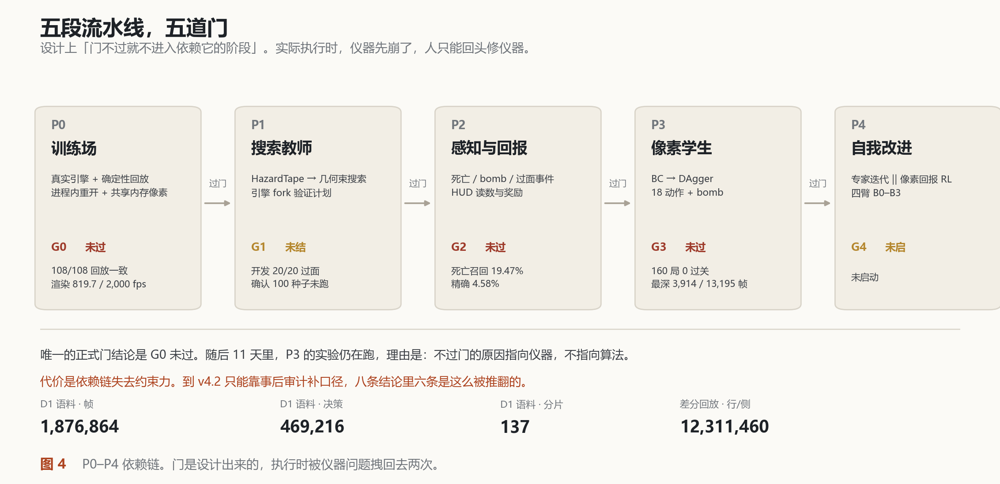
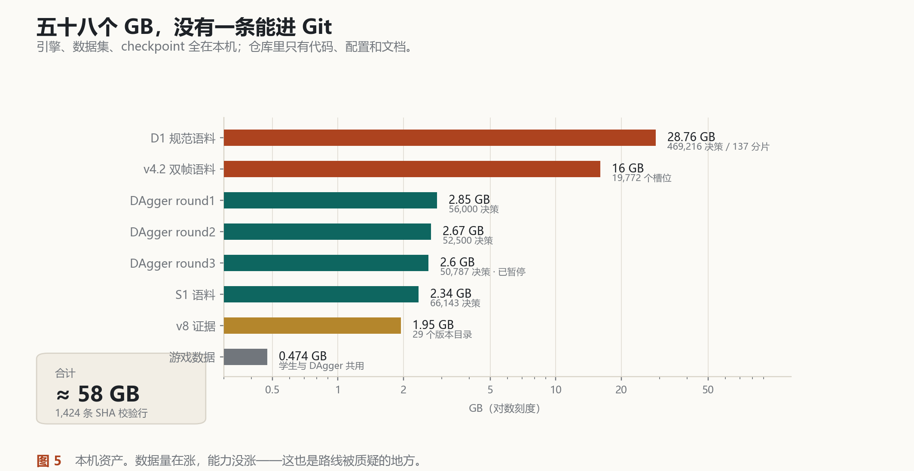
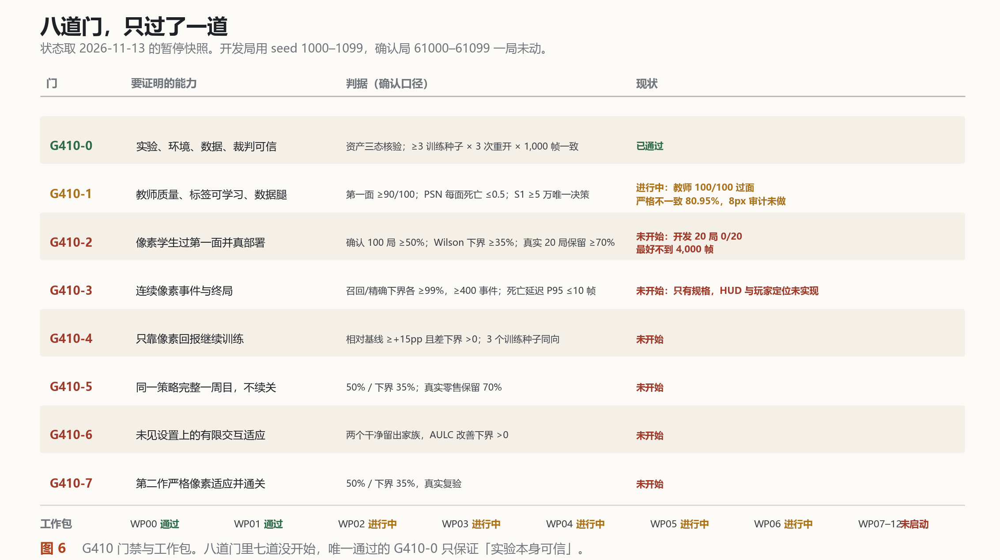
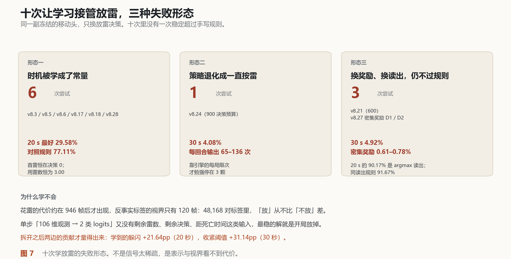
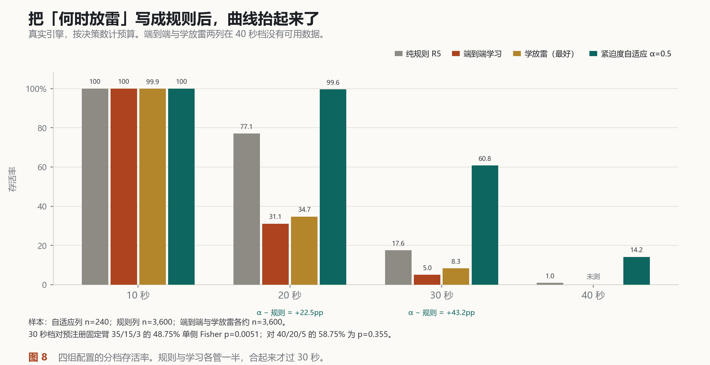
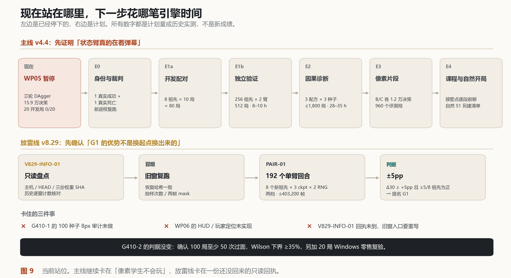

# 被证否推着走

## Touhou_RL 三十七天研究路线复盘

### 一、一份暂停快照

2026 年 11 月 13 日 16 点 20 分，`ASSET_SYNC.md` 把一个暂停快照钉在磁盘上：目标 paused，第 102 轮；G410-0 已通过；G410-1 的教师 100/100 过面，但 8px 容差审计与 PSN 多面数据腿没结；G410-2 到 G410-7 还没开始。

同一天，WP05 第三轮 DAgger 跑完：15 个分片、50,787 条决策、101,574 帧，HASH 逐帧全等。到这时，所有学生配方在 20 个开发局里都是 0 过关。

D 盘里躺着约 58 GB 资产，引擎、语料、checkpoint，一条都没进 Git。Git 里能看见的是四万多行代码、两万五千行测试，和 1,424 条 SHA-256 校验行。

这篇文章只讲一件事：这条路线怎么一步步长成现在这样。两次重建，八道门，一个始终没被替换的默认模型。

### 二、先划三条不能越的线

项目的第一条约束写在 [readme](../../readme.md)：部署形态只允许输入框选出的游戏区域像素，不读内存，不注入，不依赖具体版本。第二条：训练期可以读内存，但内存只做特权教师，产出标签、参照系和审计证据，永远不许进入部署观测。第三条：不写游戏进程内存，不改目标字节，不 hook `Present`。

这三条线决定了后面所有麻烦的形状。没有内存真值，死亡、终局、资源、奖励都得从画面里认；教师用 `PLAYER_HIT` 做的决死雷，学生未必看得见；窗口不同步时 BitBlt 会一直成功返回旧画面，仓库因此产出过 52,888 张完全相同的图，占某个数据集的 73%。还有一次，读内存按 +2 而不是 +4 偏移，读到的 padding 被当成"这一帧没有子弹"。

这些都不是算法问题。但在十月，它们看起来都像算法问题。

### 三、三十七天的形状

从 10 月 18 日第一个提交，到 11 月 23 日 v8.29 的复验设计，五十二个版本目录。摊开看，失败集中在十月下旬到十一月中旬，几乎每一次转向都发生在数字出来之后，而不是想法出来之后。

失败的颜色比成立的多。这不是因为项目偏爱失败，是因为它后来只肯把"有数字支撑的结论"算作结论，而大部分想法经不起这个标准。

### 四、第一次误判：把"看得见"当成"用得上"

10 月 18 日第一个提交只有一句说明：视觉优先架构，加 collect/process/train 流水线。两天后 v1.0.4 收尾，报告里写着 A-01/A-02 通过。

指标确实好看：危险图相关 0.82，格子命中 0.90。可自机位置误差 48 px，教师 top1 只有 0.13。到 v1.0.4，位置误差压到 2.41 px，0–15 px 危险桶的教师后悔值 1.27 px。感知这一层，看起来已经解决了。

然后真机。v1.0.2 的策略活 1,239 帧，随机策略 2,418 帧。v1.0.4 是 1,627.7 帧，逐帧 argmax 翻转 50.7%，而过关门槛是 4,000 帧。

中间还查过一次根因：数据被冻结、解码错配，采到的帧和标签对不上。v2.0 换成 PPO18 加候选×持续时间的安全教师，过了 19 项有限离线门，转真机仍然没成。v3.1 到 v3.5 的特权阶梯与区域探针也没到 A-04，区域探针 S1 fail 之后，按停止线不启动 S2。这条线不硬推。

"能看"和"用得对"是两件事。这是第一次被数据按着头改判断。

### 五、第二次误判：合成世界里的胜利

v3.6 的七策略消融里，CollectPower 把功率拉高 1069%，死亡从 1.95 涨到 4.60；ENEMY 的伤害增益 +3.63%，门槛是 15%。两个方向都没过，原因却不同：一个是没效果，一个是有效果，但代价更大。

v3.7 的 `escape` 包换了个思路，提前撤离，不做近弹微操。合成世界里 117/117 通过，可避免封死降 92.3%。上真机，1.333 死/局对基线 1.033，bomb 2.1 对 0.1。这两个数不是同一批实验，曝光也不等，v3.7.1 自己注明过。

再往后一周多，工作重心从"做策略"移到"查实验"。旧合成世界能被单一恒定动作通过，R11/R13/R15/R16 的聚合结论作废。28 个世界重造，教师 V2 28/28。像素探针在 masked 上 0.913–0.942，留出闭环 26.2% 和 19.0%，行为形态是"恒定 0/84、两段式 84/84"。它学会了在两张图之间切换，没学会看弹幕。

v3.7.4 把"画面与状态是否同帧"从不可证明变成可证明：240/240 帧，59.87 Hz，hold 中位 7.44 ms。此前 12,000 条决策里只有 26.8% 的弹池计数与引擎计数器相等，旧读法 20.83% 跨 ticket。同一时期还清掉三样东西：每个快照多出来的一颗 (0,0) 幽灵弹、两个改了也没用的伪参数 `--seed` 与 `--w-coord`、以及按决策数而不是游戏帧终止的配对。

同一周还有一次 BC 示范：9,000/9,000 帧、0 丢弃，验证 4.96%，而"保持上一动作"的基线是 97.52%。模仿学到的东西比不动还少。

这些修复不产生任何模型。但它们让后面所有的坏消息变得可信。

### 六、重建：用门禁换信任

v4.0 把路线推倒重来。P0 训练场、P1 搜索教师、P2 感知与回报、P3 像素学生、P4 自我改进，五段流水线，五道门。设计原则只有一句：门不过，就不进入依赖它的阶段。

P0 的结果是半成：108/108 份差分回放逐位一致，每侧 12,311,460 行；fork 一次 15.5 ms；但渲染加读回最好 819.7 fps，门槛 2,000，只有 41%。G0 判 NOT PASS。

同一时期 D1 语料落地：137 个分片、469,216 条决策、1,876,864 帧、28.76 GB。加上后面的 S1 语料、三轮 DAgger、v4.2 的双帧语料和 v8 的证据，本机资产到了约 58 GB。

门没过，P3 的实验还是跑了。理由不算无理：不过门的原因指向仪器，不指向算法。代价是依赖链失去约束力，后面的结论只能靠事后审计补口径。到 v4.2 结账时，八条结论里六条是推翻。

### 七、十五万九千条决策，零次过关

v4.1 把验收拆成八道门，G410-0 到 G410-7，从"实验可信"一直排到"第二作严格像素适应"。

到暂停时只有 G410-0 通过。它证明的是实验、环境、数据、裁判可信，不证明学生会玩。G410-2 才是第一面，判据是确认段 100 局至少 50 次过面，Wilson 下界不低于 35%，另加 20 局 Windows 零售复验，保留率不低于 harness 的 70%。

WP05 是这条线上最结实的一块数据。三轮 DAgger，56,000 + 52,500 + 50,787 = 159,287 条决策，注入率 1.0、0.500857、0.502629，HASH 逐帧全等。采集侧几乎没有可挑的毛病。

学生的成绩：20 个开发局，0 过关。不同配方的最好平均存活在 1,339.95 到 1,714.65 帧之间，B0 基线 1,453.25。idle（不动）占比 60.87% 到 72.06%，教师是 66.16%。

WP05.12 的 idle 诊断把话说得更死：44.58% 的决策里，18 路动作完全打平；idle 标签的 67.38% 来自这些打平行；idle 从来没有唯一最优。随机打破平局之后，反事实的 idle 只剩 4.67%。自转移率 90.43%，最长单一动作 1,334 帧。

换句话说，数据里的"正确答案"有一半是平的。降权 idle、重标平局，两次都没把 0/20 变成 1/20。而 G410-1 那边，教师 100/100 过面的同时，原始严格不一致有 270,501/334,144，80.95%，100 个种子的 8px 容差审计还没做。

数据很干净。干净不等于有用。

### 八、把八条解释挨个测一遍

v4.2 换了一套更硬的仪器，然后把之前所有解释挨个测了一遍。结果是 160 局 0 过关：4 个臂，每个 20 局，两种评测口径，最深的一局 3,914 帧，过关需要 13,195 帧。

然后是一条一条结账。

"加预算就行。" 50k 到 200k，两次运行分别 −14.0 和 −83.0 帧，边际 −0.933 与 −5.533 帧每万帧。

"折扣视界太短。" 折扣视界从 30 秒拉到 200 秒，视界末端的折扣权重从 6.5e-4 升到 0.333，审计 17/17，能力不变。

"奖励看不见首死。" 奖励与真实存活的相关，r3 是 0.9485，r2 只有 0.3545。看得见了，还是不过关。

"DAgger 更快。" 新仪器下，配对区间全跨 0。

"200k 有突破。" 正式撤回：1866.2 / 3317.3 不在任何原始产物里，真值是 1575.2 / 2808.6。百万帧的计划随之停掉。

"像素里有威力。" power 的像素在第 136–151 行、第 488–616 列，两种裁剪都没覆盖；0.66 和 0.84 是时间混淆，相关系数 0.7545，平移零分布反而更高。

"时间契约有问题。" 这条被否定：573,355 条断言，0 违反。

"KL 锚止不住漂移。" 也被否定：翻转率 0.617 → 0.0117，配对 20/20 为正。

最后一条来自仪器本身：两台仪器从约 2,000 帧起，测的是不同游戏。同一串数字，换一台机器就是另一个含义。

### 九、复核把最后一层也拆了

v4.3 的复核本来是在查学生，查到一半开始查自己的基线。

原报告说 BC 的交叉熵基线是 0.8537。复核发现那不是交叉熵，是把最大类概率取负对数。用训练集拟合的正确基线是 1.6586 / 1.7122 / 1.6639。原报告说训练/验证划分是 880/219，复核发现这个划分从未存在，实际是 879/220，按 80% 取整。

还有近重复。原判断是"前 219 条决策逐字节相同，约 20% 训练数据是原文"。复核结果是动作序列相同为真，画面 0/219 逐字节相同；它们是近重复对，画面差 0.622/255。这个差别足以让 2.7M 参数的模型全盘假赢，切掉前缀就翻负。

臂 A 的优势也从"6 倍存活率"改成"优势真实存在，但只在分布的顶端"：n=80，均值差 +14.48，置信区间 [−6.97, +37.58]，Fisher p=0.1167，中位数 −15.0。同一批起点上，一个可部署的固定动作 #12 达到 172.4，是 A 的 1.83 倍。

到这一步，"BC 有没有效"变成了一个说不清的问题。既没被证明有效，也没被证明无效。

### 十、另一条路：把放雷拆出去

v8 是另起的一支。移动交给学习，放雷交给手写规则。

拆开的理由是可测的。在 120 帧视界的反事实标签里，48,168 对样本中没有一例"放雷更差"；花雷的代价大约 946 帧后才出现，落在视界之外。端到端一起学，30 秒只有 5.00%。

规则 R5 用 40/20/5 像素三档阈值，10/20/30/40 秒是 100% / 77.11% / 17.61% / 1.00%，n=3,600。

然后十次让学习接管放雷。

六次学成"开局就放"：首雷恒在决策 0，用雷恒 3.00，20 秒最好 29.58%，规则是 77.11%。一次学成"一直按雷"：每回合输出 65–136 次，靠引擎的每局限次才停在 3 颗，30 秒 4.08%。三次换奖励、换读出：密集奖励 0.61% 和 0.78%；600 决策预算的 90.17% 是 argmax 读出（每步取最高分动作），同读出规则 91.67%，换成可部署采样是 98.75%。

α=0.5 是转折点。它不改网络，只改阈值：先算本档剩余决策除以剩余雷数，把商除以 200，再开平方，得到放缩系数；把 3/15/35 像素的基础阈值乘上系数，最后裁到 5–120 像素。预算越长、雷越少，系数越大，阈值自动放松；末段只剩一颗雷时，紧迫度反而下降，阈值收回。

结果 20/30/40 秒是 99.58% / 60.83% / 14.17%，n=240。30 秒对预注册的 35/15/3（48.75%）单侧 Fisher p=0.0051；对 40/20/5 的 58.75% 是 p=0.355。

这条线也有自己的账要认。从来没有测过击杀 Boss，所有指标都是"活满 N 个决策"；四个开发窗都参与过开发，留出窗没做；README 的能力表把"学放雷最好"写成 34.72%，那是 v8.24 的值，v8.21 的 90.17% 是另一种读出。这些更正写在 synthesis 的 §38–§39 里，没有藏。

### 十一、现在的站位

暂停不是结束，是等回执。

round3 已经跑完 15 个分片。`state.json` 停在 15:51 的快照，2,459 字节，SHA `9E484558…`；`ASSET_SYNC.md` 钉的是 16:20 的 2,465 字节，`13e0e314…`。两个快照差 14 分钟，内容也动了 6 个字节。这不是大问题，但它说明"暂停"这个状态本身也是手工维持的。

主线接着走 v4.4 的 E0–E4。先复跑一成一败两个真实结局，确认裁判身份（E0）；再做 8 个祖先的 80 局开发配对（E1a）；然后 256 个祖先 × 2 臂 = 512 局独立验证，约 8–10 个引擎小时；E2 三配方 × 三训练种子，最多 1,800 局，约 28–35 小时；E3 像素臂 960 个评测局；E4 才谈课程和自然开局。

放雷线接着走 v8.29。同一副冻结移动头，只换放雷规则，G1 对 T2，8 个新祖先 × 3 个 checkpoint × 2 个配对 RNG，两档共 192 个单臂回合，上限 403,200 个受控帧。判据冻结：30 秒档差不低于 +5pp，且至少 5/8 个祖先为正，才提名 G1。

两条线卡在同一类东西上：G410-1 的 100 种子 8px 容差审计没做，WP06 的 HUD 与玩家定位没实现，V829-INFO-01 的只读回执没到。

### 十二、路线是怎么长出来的

回头看，这条路线不是设计出来的，是被测量推着走的。

仪器先修。G0 的 41%、20.83% 的跨 ticket、改了没反应的伪参数、每个快照里的幽灵弹、按决策数终止的配对。修这些的收益，大于后来调过的任何一个超参数。

指标会骗人。+1069% 的功率，+3.63% 的伤害，0.92 的离线拟合，都曾经看起来像进展。它们各自成立，合起来不构成能力。

负结果要能复算。八条解释每条都有数字和出处；1,424 条 SHA 校验行让"同一份数据"这句话可验证。没有这一层，前面所有失败都只是故事。

这条路线目前最确定的事，是它还缺一个能过第一面的学生。其余工作，都是为了让这件事一旦发生，能被认出来。

11 月 23 日，v8.29 的工单还在等一份只读回执。训练端的 round3 目录没有再写入。

暂停就是暂停。

---

### 资料与复算入口

- 根目录说明与历史结论：[readme.md](../../readme.md)
- v4.1.0 唯一实施规格与门禁：[README.md](../Update/Alpha/v4.1.0/README.md)
- v4.2.0 路线结论（八条结论）：[ROUTE_CONCLUSION.md](../Update/Alpha/v4.2.0/ROUTE_CONCLUSION.md)
- v4.3.1 路线复核：[SUMMARY_FOR_DECISION.md](../Update/Alpha/v4.3.1/SUMMARY_FOR_DECISION.md)
- v4.4.0 当前研究计划：[RESEARCH_PLAN.md](../Update/Alpha/v4.4.0/RESEARCH_PLAN.md)
- v8 放雷线总报告与索引：[SYNTHESIS_BOMBLINE_2026-11-22.md](../Update/Alpha/v8.13.0/SYNTHESIS_BOMBLINE_2026-11-22.md)
- v8.29 复验协议：[PREREGISTRATION_PAIR_001.md](../Update/Alpha/v8.29.0/PREREGISTRATION_PAIR_001.md)
- 资产清单与校验：[ASSET_SYNC.md](../../ASSET_SYNC.md)
- 本文章的图版源文件：[build/](build/)

> 文中数字均取自上述文档的实测记录；标"计划"的是预算量，不是成绩。图版由 `build/fig0*.py` 生成，改数后重跑即可复现。
