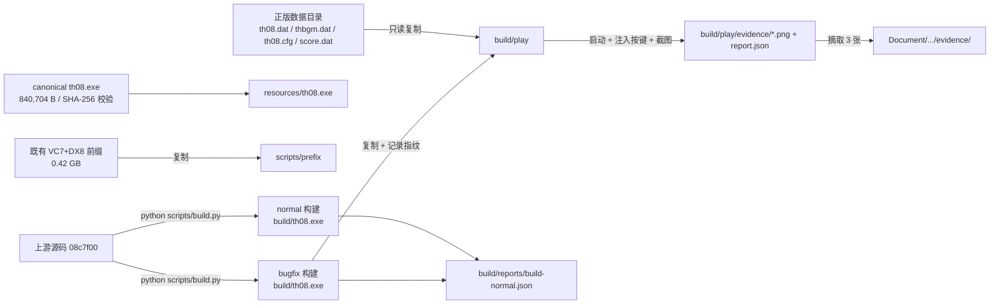

# 设计文档 · v1.0.0

- 所属阶段：Stage 2（设计）
- 需求基线：`Document/Update/Alpha/v1.0.0/需求文档.md`
- 决策基线：`Document/Update/Alpha/v1.0.0/问题清单.md` §1.1（Q-01=A、Q-02=L2、Q-03=A）
- 本文档自包含：不依赖任何对话历史，读者仅凭本文档 + 仓库现状即可执行 Stage 3。

---

## 1. 背景与目标

`third_party/th08` 是东方永夜抄（TH08）1.00d 的**逐字节重建**工程（上游 `N0zoM1z0/th08`，子模块提交 `08c7f00`）。仓库已恢复全部 1,107 个函数源码，并提供 VC7 原生编译链路。

本项目的终极目标（见根仓库 `readme.md`）是用强化学习通过"框选游戏区"让模型自主学习游玩东方系列。因此需要一个**与逆向工程同构**、可反复启动与调试的 th08 运行体，作为后续"状态提取 → 回馈强化学习"的数据源。

v1.0.0 的目标只是把这块地基立稳：

1. 在本机（Windows）从零复现"VC7 原生重建 → 可运行 exe"的完整链路；
2. 用正版日语 1.00d 数据把游戏**真的跑起来**，并走到 Stage 1 实际游玩；
3. 把这条链路做成可一键复现的脚本 + 证据 + 文档，供后续版本在此之上接调试与状态导出。

## 2. 范围

### 2.1 范围内

| 编号 | 内容 |
| --- | --- |
| IN-1 | 私有构建环境自举：VC7 工具链 + DirectX 8 SDK + ninja 前缀、canonical 目标二进制落位与校验 |
| IN-2 | 双构建：`normal`（精确性证据用）+ `bugfix`（运行用），冷构建、串行、单写者 |
| IN-3 | 运行目录装配：正版数据 + 窗口化配置 + bugfix 产物，含完整性与指纹清单 |
| IN-4 | 启动/操作/证据自动化：启动、置前台、注入按键、客户区截图、日志审计、退出码判定、报告落盘 |
| IN-5 | L2 验收路径：标题 → 难度选择 → 队伍选择 → Stage 1 实际游玩（移动/射击/暂停）→ 正常退出 |
| IN-6 | 单元测试（正常路径 + 边界/异常）+ 一键端到端验证脚本 |
| IN-7 | 零上下文文档：设计、开发任务书、验收项、复现步骤、证据归档 |

### 2.2 范围外（且禁止在本版实施）

| 编号 | 禁止事项 | 原因 |
| --- | --- | --- |
| OUT-1 | 修改 `third_party/th08/src/**`、`scripts/**`、`config/**` 等上游受版本管理文件 | 上游 AGENTS.md 要求单写者、干净工作区；本版只消费上游 |
| OUT-2 | 任何 reccmp / objdiff "精确匹配" 声明 | 需 `verify-exact-units.py --all` 的冷构建聚合证据，属独立门禁；本版只报 PE 身份与构建成功 |
| OUT-3 | 安装 WSL/Wine、做 Linux 或现代 Windows 移植 | Q-01=A 已定 |
| OUT-4 | 实现 RL 环境接口、状态导出、replay 确定性回放 | Q-02=L2 已定，留待 v1.1 |
| OUT-5 | 提交（commit/push）任何零售数据、目标二进制、工具链、构建产物 | 上游规则 + 法律约束 |
| OUT-6 | 修改上游 `config/claims.csv`（须保持仅表头） | 上游 AGENTS.md 明确要求 |

## 3. 现状基线（零上下文事实）

| 编号 | 事实 |
| --- | --- |
| B-01 | 仓库根：`D:\WorkShop\Touhou_RL`；子模块：`third_party\th08` @ `08c7f00`，工作区干净；`3rdparty/Detours` 已初始化 |
| B-02 | 正版日语数据目录：`D:\Games\[th08] 东方永夜抄 (日文版)\[th08] 东方永夜抄 (日文版)\`。`th08.exe` 840,704 B / SHA-256 `330FBDBF58A710829D65277B4F312CFBB38D5448B3DF523E79350B879213D924`（与上游 `AGENTS.md`、`docs/ARCHITECTURE.md` 一致）；`th08.dat` 46,838,025 B；`thbgm.dat` 449,961,024 B；`score.dat` 17,774 B；`th08.cfg` 60 B（`windowed=0`） |
| B-03 | 私有工具链前缀（已完成准备）：`D:\WorkShop\th08-main\th08-main\scripts\prefix`，9,252 文件 / 0.42 GB。含 `PROGRAM FILES\MICROSOFT VISUAL STUDIO .NET\VC7\BIN\CL.EXE`（13.00.9466）、`mssdk\include\d3dx8.h`、`mssdk\lib\d3dx8.lib`、`ninja\ninja.exe`（1.6.0）、`python\`（3.4.4，仅被 ninja 规则内的 `python` 调用使用） |
| B-04 | 本机 Python 3.12.10：`C:\Users\a5935\AppData\Local\Programs\Python\Python312\python.exe`。上游 `scripts/configure.py` 使用 `tomllib`，**必须 ≥3.11** |
| B-05 | 上游构建入口：`scripts/build.py --build-type <normal\|bugfix> [--fresh] [-j N]`，内部依次 `configure()` 生成 `build.ninja`、再经 `scripts/th08run.bat`（`th08vars.bat` 设置 PATH/INCLUDE/LIB）调 `ninja`。原生 Windows 下 `scripts/winhelpers.py` 直接 `subprocess.check_call`，不经 Wine |
| B-06 | 已实测（本机）：用旧副本的 bugfix 产物 + 正版数据（staged 到 `third_party/th08/build/play`，`th08.cfg` 的 `0x22` 字节置 1）可启动：8,238 ms 出窗口，标题 `東方永夜抄 ～ Imperishable Night. ver 1.00d`，客户区 640x480；日志含 `T&L HAL で動作`、`DirectSound は正常に初期化されました`、`KeyBoard OK`；`WM_CLOSE` 后退出码 0；已回写 `log.txt`/`th08.cfg`/`score.dat` |
| B-07 | 输入链路：`Supervisor::SetupDInput` 中键盘为 `DISCL_FOREGROUND | DISCL_NONEXCLUSIVE | DISCL_NOWINKEY`（`src/Supervisor.cpp:937`），**必须前台窗口**；键位见 `src/Global.cpp:733-756`（Z=确认/射击、X=Bomb、Shift=低速、Esc=菜单、Ctrl=跳过、方向键移动、Enter=确认） |
| B-08 | 标题菜单索引（`src/TitleScreen.cpp:81-91`）：0 Start、1 Extra Start、2 Spell Practice、3 Practice Start、4 Replay、5 Result、6 Music Room、7 Option、8 Quit；未解锁项会被跳过（`TitleScreen.cpp:388-404`）。标题空闲 1,500 帧（约 25 s）后自动播放 demo（`TitleScreen.cpp:434`），自动化必须在此时限内动作 |
| B-09 | 标题菜单按 `X`/`Esc` 会把光标直接移到 Quit（`TitleScreen.cpp:601-608`）；Quit 确认后 60 帧退出（`TitleScreen.cpp:610-622`），走正常退出路径 |
| B-10 | 进入游戏流程：标题 Start（Z）→ `DifficultySelect`（cursor=cfg.defaultDifficulty=1=NORMAL）→ Z → `CharacterSelect`（队伍选择）→ Z → 进入 Stage 1（`TitleScreen.cpp:494-510`、`:1508-1535`、`:1755-1790`） |
| B-11 | 游戏内 `Esc` 打开暂停菜单（`src/GameManager.cpp:431-448`，`isInGameMenu=1`） |
| B-12 | 配置文件结构：`GameConfiguration` 共 0x3C(60) 字节；`windowed` 在偏移 `0x22`，`version` 在偏移 `0x14`（值 `0x00080001`）。校验规则见 `src/Supervisor.cpp:1432-1443`：`windowed<2`、`fileSize==60`、`version==GAME_VERSION` 等；游戏启动后会原样回写该文件 |
| B-13 | bugfix 与 normal 的差异只有 3 处：`Supervisor.cpp:1883`（版本表放行）、`AnmManager.cpp:2325`（ANM 空指针防护）、`ResultScreen.cpp:1263`（结算页精灵堆积）。normal 构建因零售版本身份校验不可运行（`docs/WINDOWS_I386_RUNTIME.md:136-151`） |
| B-14 | 子模块 `.gitignore` 已忽略：`build`、`scripts/prefix`、`/resources/th08.exe`、`*.exe`、`*.dat`、`build.ninja`、`__pycache__`（`.gitignore:1-13`） |
| B-15 | 环境：Windows 11 家庭版 10.0.26300、RTX 4070 SUPER、双屏 2048x1152 + 1920x1080；`C:\Windows\SysWOW64` 具备 `d3d8.dll`/`dinput8.dll`/`dsound.dll`；无 `d3dx8.dll`（不需要，`d3dx8.lib` 静态链接） |
| B-16 | PowerShell 为 Windows PowerShell 5.1，脚本执行策略禁用：必须以 `powershell -NoProfile -ExecutionPolicy Bypass -File <script>` 调用。Git 在 `C:\Program Files\Git\cmd\git.exe`（不在 PATH） |
| B-17 | 磁盘：C: 848 GB 空闲 / D: 1,444 GB 空闲；运行目录当前 474.8 MB |
| B-18 | 目标 exe 与运行目录同一盘符（D:），如需硬链接可行；本版默认复制 |

## 4. 总体架构

### 4.1 分层

```
上层编排   Verify.ps1（一键：环境 → 构建 → 装配 → 运行 → 汇总）
           └─ 脚本层  Prepare-Environment.ps1 / Build.ps1 / Stage-Runtime.ps1 / Run.ps1
              └─ 模块层  tools/th08/Th08Pipeline.psm1（纯函数，可单测）
                 ├─ 校验域  Assert-Th08Target / Get-Th08PeInfo / Assert-Th08PeInfo
                 ├─ 配置域  Write-Th08WindowedConfig
                 ├─ 装配域  Get-Th08RuntimeManifest / Assert-Th08Runtime / Initialize-Th08Runtime
                 ├─ 构建域  Resolve-Th08Python / Invoke-Th08Build
                 └─ 运行域  Read-Th08KeyScript / Invoke-Th08Run / Test-Th08LogAudit
                    └─ 外部依赖（只读消费，不修改）
                       上游 scripts/build.py + th08run.bat + build.ninja（VC7/ninja）
                       零售数据（只读复制）
                       Win32 API（user32/d3d8 由游戏自身使用；脚本只用 user32）
```

### 4.2 目录布局（新增物以 `+` 标注）

| 路径 | 归属 | 说明 |
| --- | --- | --- |
| `+ tools/th08/Th08Pipeline.psm1` | 根仓库 | 全部可测逻辑 |
| `+ tools/th08/Prepare-Environment.ps1` | 根仓库 | 环境自举入口 |
| `+ tools/th08/Build.ps1` | 根仓库 | 双构建入口 |
| `+ tools/th08/Stage-Runtime.ps1` | 根仓库 | 运行目录装配入口 |
| `+ tools/th08/Run.ps1` | 根仓库 | 单次运行入口（可指定 profile/tag） |
| `+ tools/th08/Verify.ps1` | 根仓库 | 一键端到端验证 + 汇总报告 |
| `+ tools/th08/profiles/l2-gameplay.json` | 根仓库 | L2 游玩运行键脚本（含截图点） |
| `+ tools/th08/profiles/l2-menuexit.json` | 根仓库 | 菜单退出运行键脚本 |
| `+ tools/th08/tests/Invoke-UnitTests.ps1` | 根仓库 | 自包含单测运行器（不依赖 Pester） |
| `+ Document/Update/Alpha/v1.0.0/**` | 根仓库 | 设计/开发/验收/报告 + 关键证据副本 |
| `third_party/th08/scripts/prefix/` | 子模块内（gitignored） | VC7 + DX8 SDK + ninja + python |
| `third_party/th08/resources/th08.exe` | 子模块内（gitignored） | canonical 目标（840,704 B） |
| `third_party/th08/build/build.ninja` 等 | 子模块内（gitignored） | 上游构建图与产物 |
| `third_party/th08/build/play/` | 子模块内（gitignored） | 运行目录（数据 + exe + cfg + replay/backup） |
| `third_party/th08/build/play/evidence/` | 子模块内（gitignored） | 每次运行的截图、日志副本、JSON 报告 |
| `third_party/th08/build/reports/` | 子模块内（gitignored） | 构建/装配/验证 JSON 报告 |

### 4.3 数据流



## 5. Stage / SubStage 划分

| Stage | SubStage | 目标 | 依赖前置 | 并行状态 | 交付物 |
| --- | --- | --- | --- | --- | --- |
| Stage 1 提问 | — | 事实基线 + 问题清单 | 无 | — | `问题清单.md`（v2，置顶区已清空） |
| Stage 2 设计 | — | 设计/开发/验收文档 | Stage 1 | — | 本文档、`开发文档/**`、`验收文档.md` |
| Stage 3 开发 | S3-1 环境自举 | prefix + canonical 目标落位并校验 | 无 | 必须串行（唯一写者，禁止与 S3-2 并行） | `Th08Pipeline.psm1` 校验/环境函数、`Prepare-Environment.ps1`、报告 |
| Stage 3 开发 | S3-2 双构建 | normal、bugfix 冷构建 + PE 体检 + 指纹 | S3-1 | 必须串行（禁止并行 VC7 构建） | `Invoke-Th08Build`/`Resolve-Th08Python`、`Build.ps1`、`build-report-*.json` |
| Stage 3 开发 | S3-3 运行目录装配 | 数据 + 窗口化 cfg + exe 落位、清单校验 | S3-2（需 bugfix 产物） | 可与 S3-5 的测试编写并行（不同文件） | `Initialize-Th08Runtime`/`Assert-Th08Runtime`、`Stage-Runtime.ps1`、`runtime-manifest.json` |
| Stage 3 开发 | S3-4 启动与证据自动化 | 启动/前台校验/按键/截图/审计/退出 | S3-3 | 必须串行（同一时刻仅一个游戏进程） | `Invoke-Th08Run`/`Read-Th08KeyScript`/`Test-Th08LogAudit`、`Run.ps1`、2 个 profile、run report |
| Stage 3 开发 | S3-5 单元测试与一键验证 | ≥14 条单测 + 端到端 `Verify.ps1` | S3-1..S3-4 的函数齐全 | 可最后执行 | `Invoke-UnitTests.ps1`、`Verify.ps1`、`verify-report.json` |
| Stage 3 开发 | S3-6 证据归档与文档定稿 | 证据副本、复现手册、完成报告 | S3-4、S3-5 | 与前序串行 | 文档定稿、`Stage3/完成报告.md` |
| Stage 4 验收 | — | 按 `验收文档.md` A-01..A-11 逐项判定 | Stage 3 完成 | 只读验收（由零上下文验收 Agent 执行） | `验收报告.md`、`总结报告.md` |

**并发约束（硬性）**：S3-1..S3-2 涉及 VC7/链接器，全程 `-j 1`、单写者，不得派发 SubAgent 执行，也不得与其它构建并行；S3-4 任何时刻只允许一个 `th08.exe` 进程。SubAgent 只允许用于**只读**检查或**根仓库内**独立文档工作。

## 6. 跨 Stage 契约

### 6.1 常量表（唯一真源，脚本内以此为准）

| 名称 | 值 |
| --- | --- |
| `RepoRoot` | 由脚本位置推导：`$PSScriptRoot` 为 `tools/th08`，其上两级 |
| `Th08Root` | `<RepoRoot>\third_party\th08` |
| `TargetExePath` | `<Th08Root>\resources\th08.exe` |
| `TargetSize` | `840704` |
| `TargetSha256` | `330FBDBF58A710829D65277B4F312CFBB38D5448B3DF523E79350B879213D924`（比较时统一大写） |
| `PrefixDir` | `<Th08Root>\scripts\prefix` |
| `PrefixSourceDefault` | `D:\WorkShop\th08-main\th08-main\scripts\prefix` |
| `RetailDataDirDefault` | `D:\Games\[th08] 东方永夜抄 (日文版)\[th08] 东方永夜抄 (日文版)` |
| `BuildDir` | `<Th08Root>\build` |
| `PlayDir` | `<BuildDir>\play` |
| `EvidenceDir` | `<PlayDir>\evidence` |
| `ReportsDir` | `<BuildDir>\reports` |
| `DataFile` | `th08.dat` = `46838025` B |
| `BgmFile` | `thbgm.dat` = `449961024` B |
| `ScoreFile` | `score.dat` = `17774` B（可选） |
| `CfgLength` | `60` |
| `CfgWindowedOffset` | `0x22`（值必须为 `1`） |
| `CfgVersionOffset` | `0x14`（值必须保留 `0x00080001`） |
| PE 期望 | `Machine=0x014C`、`Subsystem=2`(GUI)、`ImageBase=0x00400000`、`IsPe32=$true` |
| VK 码 | Z=`0x5A`、X=`0x58`、Esc=`0x1B`、Enter=`0x0D`、Shift=`0x10`、Ctrl=`0x11`、Up=`0x26`、Down=`0x28`、Left=`0x25`、Right=`0x27` |
| 时间预算 | 窗口超时 30 s；按键前等待 ≥800 ms；关闭等待 10 s；单次运行总时长上限 60 s（超时即强制关闭并判失败） |

### 6.2 错误码与退出码

异常消息统一格式：`TH08-E<两位编号>: <说明>（<上下文键=值>）`。模块函数抛 `System.Exception`，脚本把异常映射为退出码。

| 错误码 | 含义 | 触发点 |
| --- | --- | --- |
| `E01` | 私有前缀不完整（缺 `CL.EXE` / `d3dx8.h` / `d3dx8.lib` / `ninja.exe`） | S3-1 |
| `E02` | 目标二进制缺失、尺寸或 SHA-256 不符 | S3-1 |
| `E03` | 零售数据缺失或尺寸不符 | S3-3 |
| `E04` | 构建失败（`build.py`/`ninja`/`cl` 非零返回） | S3-2 |
| `E05` | 构建产物体检失败（非 PE32 / Machine 非 0x014C / Subsystem 非 2 / 空文件） | S3-2 |
| `E06` | 运行目录装配/清单校验失败（缺文件、尺寸不符、cfg 长度或字段非法） | S3-3 |
| `E07` | Python ≥3.11 不可用 | S3-2 入口 |
| `E08` | 按键注入前置条件失败（前台窗口非游戏窗口，重试 3 次仍失败） | S3-4 |
| `E09` | 日志审计不通过（缺必需标记或命中禁用标记） | S3-4 |
| `E10` | 游戏退出码非 0 或进程异常终止 | S3-4 |
| `E11` | 截图空白（像素多样性低于阈值） | S3-4 |
| `E12` | 键脚本非法（未知 action、缺字段、值越界） | S3-4 |

脚本退出码：`0` 成功；`2` 前置条件缺失（E01/E03/E07）；`3` 校验失败（E02/E05/E06）；`4` 构建失败（E04）；`5` 运行失败（E08/E09/E10/E11/E12）；`6` 单测失败；`1` 其它未预期异常（含 PowerShell 自身错误）。

### 6.3 模块接口契约（`tools/th08/Th08Pipeline.psm1`）

所有函数必须：PowerShell 5.1 兼容；不写除声明外的文件；输出 `[pscustomobject]`；失败抛 `TH08-Exx:` 异常。模块被 `Import-Module -Force` 引入后即可调用。

| 函数 | 签名 | 行为 | 失败 |
| --- | --- | --- | --- |
| `Get-Th08Context` | `[-RepoRoot <string>]` | 返回上下文：`RepoRoot,Th08Root,ToolsDir,TargetExePath,PrefixDir,BuildDir,PlayDir,EvidenceDir,ReportsDir,ScriptsDir,PythonExe` | 目录不存在 → E01 |
| `Resolve-Th08Python` | `[-PythonExe <string>]` | 解析顺序：显式参数 → PATH 中非 WindowsApps 桩且 `--version` ≥3.11 → `%LOCALAPPDATA%\Programs\Python\Python3*\python.exe` 中最高版本 | 全部失败 → E07 |
| `Assert-Th08Prefix` | `-Path <string>` | 校验前缀四项：`PROGRAM FILES\MICROSOFT VISUAL STUDIO .NET\VC7\BIN\CL.EXE`、`mssdk\include\d3dx8.h`、`mssdk\lib\d3dx8.lib`、`ninja\ninja.exe`；返回 `ClPath,D3dx8Header,D3dx8Lib,NinjaPath,FileCount,Bytes` | E01 |
| `Assert-Th08Target` | `-Path <string> [-ExpectedSize][-ExpectedSha256]` | 校验尺寸 + SHA-256（大写比较） | E02 |
| `Get-Th08PeInfo` | `-Path <string>` | 解析 DOS/PE 头，返回 `IsPe32,Machine,Subsystem,ImageBase,Size` | 非 PE → E05 |
| `Assert-Th08PeInfo` | `-Path <string> [-ExpectedMachine 0x014C][-ExpectedSubsystem 2][-ExpectedImageBase 0x00400000]` | 组合 `Get-Th08PeInfo` 并断言 | E05 |
| `Write-Th08WindowedConfig` | `-SourceCfg <string> -Destination <string>` | 读 60 字节源 cfg，置 `0x22=1`，保留其余字节（含 `0x14` 版本），写目标；返回 `Path,Length,Windowed,Version,Sha256` | 源长度≠60 → E06 |
| `Get-Th08RuntimeManifest` | `-DataDir <string> -ExePath <string> [-CfgPath][-IncludeScoreDat]` | 生成待复制清单（相对名 + 期望尺寸 + 来源 + 动作 `copy`/`write-cfg`） | 来源缺失/尺寸不符 → E03 |
| `Initialize-Th08Runtime` | `-Context <object> -DataDir <string> [-CfgSource <string>][-Refresh][-UseHardLink]` | 建目录（`play`,`replay`,`backup`,`evidence`），复制/链接数据、生成 cfg、复制 exe，写 `runtime-manifest.json` | E03/E06 |
| `Assert-Th08Runtime` | `-Context <object>` | 校验运行目录：文件齐全、尺寸符合常量、`cfg[0x22]==1`、`cfg[0x14]==0x00080001`、exe 与 bugfix 产物哈希一致（若记录存在） | E06 |
| `Invoke-Th08Build` | `-Context <object> -BuildType <normal\|bugfix> [-Fresh][-Jobs 1] [-TimeoutMinutes 30]` | 以 `cwd=Th08Root` 调 `python scripts\build.py --build-type <t> [--fresh] -j <n>`；成功后体检 PE 并写 `build/reports/build-<t>.json` | E04/E05 |
| `Read-Th08KeyScript` | `-Path <string>` | 解析/校验 profile JSON，返回规范化步骤数组 | E12 |
| `Test-Th08LogAudit` | `-LogPath <string>` | CP932 解码；检查必需标记与禁用标记；返回 `Pass,RequiredMissing,ForbiddenFound,Length` | E09（由调用方按 `Pass` 判定） |
| `Invoke-Th08Run` | `-Context <object> -ProfilePath <string> [-Tag <string>][-WindowTimeoutSeconds 30][-TotalTimeoutSeconds 60]` | 完整运行流程（§6.6），返回并落盘 run report | E08/E09/E10/E11/E12 |

### 6.4 数据契约（JSON）

**键脚本 profile**（`tools/th08/profiles/*.json`）：

```json
{
  "schema": "th08-key-script/1",
  "name": "l2-gameplay",
  "steps": [
    {"action": "wait", "ms": 2500, "shot": "01-title"},
    {"action": "key", "vk": 90, "holdMs": 120, "shot": "02-difficulty"},
    {"action": "hold", "vk": 39, "ms": 400, "shot": null},
    {"action": "shot", "name": "05-stage1-move"},
    {"action": "close"}
  ]
}
```

步骤约束：`action ∈ {wait,key,hold,shot,close}`；`wait.ms ∈ [50, 30000]`；`key.vk ∈ [1,255]`；`key.holdMs ∈ [30, 2000]`；`hold.ms ∈ [50, 30000]`；`shot` 名称匹配 `^[0-9A-Za-z_-]{1,40}$`；`close` 只能是最后一步（缺省则脚本结束时自动加入）。未知 action、字段缺失、越界 → E12。

**build report**（`build/reports/build-<type>.json`）：
`schema, buildType, startedAt, durationSeconds, pythonExe, pythonVersion, command, exitCode, artifact{path,size,sha256,codeSha256,pe{machine,subsystem,imageBase,isPe32}}, logTail[≤20 行]`

> `sha256` 是整文件哈希；链接器会写入 PE `TimeDateStamp`，两次相同构建的整文件哈希因此不同。`codeSha256` 是 `.text` 节原始字节的 SHA-256，用于证明代码生成可复现，S3-2 门禁与 A-03 均以它为准。

**runtime manifest**（`build/play/runtime-manifest.json`）：
`schema:"th08-runtime-manifest/1", createdAt, note, dataDir, files[{Name,Size,Sha256,Source,Action,Mutable}], cfg{Length,Windowed,Version}, exe{buildType,Size,Sha256}`

> 字段名以实际序列化为准：`files[]`/`cfg` 为 PascalCase（与模块内部对象一致），`exe` 为 camelCase；run report 的 `shots[]` 为 camelCase。清单是**装配时刻的快照**：`Mutable=true` 的条目（如 `score.dat`）会被游戏在运行时重写，其哈希不得用于事后一致性判定；`th08.dat`/`thbgm.dat`/`th08.exe`/`th08.cfg` 为 `Mutable=false`，必须与实测一致。默认装配不包含 `score.dat`。

**run report**（`build/play/evidence/<runId>_report.json`）：
`schema:"th08-run-report/1", runId, tag, profile, startedAt, exe{path,size,sha256}, process{pid,firstWindowMs,windowTitle,windowTitleUnicode,clientWidth,clientHeight}, steps[{index,action,ok,details,screenshot}], shots[{name,path,width,height,distinctColors,meanLuma}], exit{code,forced,method}, log{path,sha256,audit{pass,requiredMissing,forbiddenFound,length,reason}}, foregroundChecks, totalSeconds, pass, failure`

**窗口标题编码契约**：TH08 通过 ANSI 接口以 Shift-JIS 设置标题，Windows 的 Unicode 取值会按系统 ANSI 代码页误解码。因此 `windowTitle` 由 `GetWindowTextA` 的原始字节按 **CP932** 解码得到（权威值），`windowTitleUnicode` 保留 `GetWindowTextW` 的结果仅供诊断；任何字符串比较以 `windowTitle` 为准。

其中 `exit.method ∈ {"natural","wm-close","forced"}`：`natural` = 进程在 profile 步骤结束后自行退出（菜单退出路径）；`wm-close` = 由脚本发送 `WM_CLOSE`；`forced` = 超时后强制结束。`forced=true` 时验收一律判失败。

**verify report**（`build/reports/verify-report.json`）：
`schema:"th08-verify-report/1", startedAt, finishedAt, steps[{name,ok,exitCode,detail}], pass`

### 6.5 日志审计契约（`build/play/log.txt`，CP932）

- 必需标记（全部命中才通过）：`DirectSound` 与 `KeyBoard`（B-06 实测 retail 级启动日志必含这两类行）。
- 禁用标记（命中任一即失败）：`Fatal`、`致命的`、`ERROR:`、`Error :`。
- 文件不存在或长度为 0 → 失败（E09）。
- 审计结果写入 run report，并把该次 `log.txt` 复制为 `<runId>_log.txt`。

### 6.6 运行流程契约（`Invoke-Th08Run`）

1. 前置：`Assert-Th08Runtime` 通过；无同名 `th08.exe` 进程残留（有则判 E10 并报告，绝不擅杀他进程）；键脚本已校验。
2. 启动：`Start-Process -FilePath <PlayDir>\th08.exe -WorkingDirectory <PlayDir> -PassThru`，记录 `runId=yyyyMMdd-HHmmss`。
3. 等窗口：250 ms 轮询 `MainWindowHandle`，超时 → E08；进程提前退出 → E10（消息含退出码）。
4. 置前台：`SetForegroundWindow` + 校验 `GetForegroundWindow()==hwnd`，最多 3 次；失败 → E08。
5. 执行步骤：`wait` 只在 `ms` 内轮询进程存活；`key`/`hold` 注入前重新校验前台窗口（不满足 → 重试 3 次 → E08）；`shot` 截取客户区（`ClientRect → ClientToScreen → CopyFromScreen`）并计算 `distinctColors`/`meanLuma`，低于阈值（`distinctColors<64` 或 `meanLuma<2`）→ E11；任何步骤截图均写 `EvidenceDir`。
6. 退出：若步骤含 `close` 或运行到末尾，优先按 profile 结束方式；未指定则 `PostMessage WM_CLOSE` 并等待 ≤10 s；仍未退出则 `Stop-Process -Force` 并记 `forced=true`（判 A-05 失败，但报告保留）。
7. 判定：退出码必须为 0；日志审计必须通过；必需截图（`01-title`、`02-difficulty`、`03-character`、`04-stage1-start`、`06-stage1-play`）必须存在且非空；任一不满足 → E09/E10/E11。
8. 报告：无论成功失败都写 `<runId>_report.json` 与 `<runId>_log.txt`（若日志存在）。

### 6.7 证据与命名

- 截图：`<EvidenceDir>\<runId>_<shot 名称>.png`；报告：`<EvidenceDir>\<runId>_report.json`；日志副本：`<EvidenceDir>\<runId>_log.txt`。
- 文档副本：`Document/Update/Alpha/v1.0.0/evidence/` 只放 ≤4 张关键截图（标题、Stage 1 游玩、暂停、退出前后之一），文件名与 runId 对应，并在总结报告登记来源 runId。

## 7. 关键设计决策

| 编号 | 决策 | 依据 |
| --- | --- | --- |
| DD-01 | 运行体 = bugfix 构建；normal 只作出具体检与 `build-report-normal.json` | B-13；问题清单 D-01 |
| DD-02 | 私有前缀与 canonical 目标从既有副本复制，不重新下载 VS.NET 2002 介质 | B-03（`create_devenv.py` 需 `scripts/dls`，当前为空） |
| DD-03 | 运行目录用**复制**而非硬链接（默认），`-UseHardLink` 仅作可选 | 避免任何写入风险传导到正版目录（B-02） |
| DD-04 | 一律窗口化（`cfg[0x22]=1`）640x480，便于定点截图与不扰动双屏桌面 | B-12；问题清单 D-05 |
| DD-05 | 前台校验 + 每次注入前复查，避免按键打到其它窗口 | B-07；Q-03 授权边界 |
| DD-06 | 退出优先走游戏内菜单（标题 `Esc`→`Z` 即 Quit，B-09）；`WM_CLOSE` 作为通用兜底 | B-09、B-06 |
| DD-07 | 日志审计用"必需标记 + 禁用标记"双白/黑名单，不用模糊正则 | B-06 实测日志；避免误判 |
| DD-08 | 单测自包含（不依赖 Pester），逐条打印 `PASS/FAIL <id>` | 本机未安装 Pester，且需零依赖可复现 |
| DD-09 | 构建与运行严格串行；S3-3/S3-5 的文件编写可并行，但执行必须串行 | 上游 AGENTS.md 单写者约束；B-05 |
| DD-10 | 一切私有材料只落 gitignored 路径，交付前用 `git status --short` 佐证 | B-14；上游规则 |
| DD-11 | L2 拆成两个运行：`l2-gameplay`（游玩 + 暂停截图 + `WM_CLOSE` 退出）与 `l2-menuexit`（标题菜单 Quit 退出） | 游玩中断点后继续在暂停菜单内导航不可靠（菜单项未知），菜单退出用标题 Quit 更稳（B-08/B-09） |
| DD-12 | 开发期间检测到同一工作区存在并发会话（反复启动 `build\play\th08.exe` 做 I/O 探针并锁住数据文件）。经用户决策（接管）结束对方进程后独占运行目录；实现上不改目录结构 | 并发冲突无法在没有裁决的情况下安全推进；用户 2026-10-18 明确选择“直接接管” |
| DD-13 | 复现性判据由整文件 SHA-256 改为 `artifact.codeSha256`（`.text` 节哈希） | 实测两次冷构建整文件哈希不同：链接器写入 PE `TimeDateStamp`；`.text` 哈希两次完全一致 |
| DD-14 | 退出路径以游戏自身菜单为准（标题 `Esc`→`Z` 走 Quit）；暂停菜单只做证据截图，不盲导航菜单项 | `TitleScreen.cpp:601-622` 提供确定的退出路径；暂停菜单项未在源码中定位 |
| DD-15 | 运行器声明进程 DPI 感知（`SetProcessDpiAwareness(2)`），并以 `__COMPAT_LAYER=HIGHDPIAWARE` 启动游戏 | 125% 缩放下坐标被虚拟化导致截图偏移；兼容层让游戏输出真 640x480 像素，便于后续像素级 RL 观测 |
| DD-16 | 每步重新解析游戏窗口句柄（`EnumWindows` + 最大客户区），不缓存单一 HWND | 游戏启动期会重建窗口（实测 t≈2 s 句柄变化），缓存句柄会导致客户区 0x0 |
| DD-17 | 运行器区分 `natural` / `wm-close` / `forced` 三种退出方式；无 `close` 步的 profile 允许 `exit 0` 自然退出并通过 | 菜单 Quit 是正常退出，不应判失败；`forced` 一律判失败 |
| DD-18 | 每次启动前删除 `play\log.txt`，日志审计只认本轮写出的日志 | 旧日志会让审计假通过（实测 035001 次运行） |

## 8. 风险与缓解

| 编号 | 风险 | 影响 | 缓解 |
| --- | --- | --- | --- |
| R-01 | DirectInput 前台键盘注入不生效 | 无法自动化到 Stage 1 | 先做最小注入试验（标题 Z 是否推进到难度选择，以截图差异判定）；若失败，回退方案：把 `GameConfigOpts.dontUseDirectInput` 置 1（`Supervisor.hpp:55`）走 `GetKeyboardState` 路径；再失败则改为半自动（人工按键 + 脚本截图）并升级问题清单 |
| R-02 | 冷构建耗时不可预估，或 VC7 在本机对新路径敏感 | 拖延进度 | 先做单对象探针构建（`build.py --object-name utils`）验证前缀可用，再跑全量；失败按 S3 门禁重试 ≤3 次 |
| R-03 | `--fresh` 清空 `build/` 影响已装配运行目录 | 运行目录被删 | 运行目录固定在 `build/play`，且 `build.py --fresh` 只清 ninja 声明的产物；装配脚本幂等，可随时重建 |
| R-04 | 截图全黑（D3D8 窗口） | 证据无效 | B-06 已证明前台截图有内容；若复现黑屏，改为先把窗口置前台再截，并保留 `E11` 判定避免假通过 |
| R-05 | 标题空闲 1,500 帧自动进 demo | 打乱流程 | 首个 `wait` ≤2,500 ms，且在 demo 触发前完成 Start 选择 |
| R-06 | 零售 `score.dat` 含未解锁状态导致菜单跳项 | 光标位置错 | 截图逐步核对；必要时改用正版目录下 `全开档` 内的存档（仅在验收报告中说明来源） |
| R-07 | 误杀用户其它进程 | 用户损失 | 只操作本次 `Start-Process` 返回的 PID；强制关闭前校验进程路径位于 `PlayDir` |
| R-08 | 私有材料被提交 | 合规风险 | 交付前执行 `git status --short`（根仓库与子模块各一次）并写入报告 |

## 9. 阶段门禁

| 门禁 | 条件 |
| --- | --- |
| Stage 2 → Stage 3 | 本文档、`开发文档/` 全部任务书、`验收文档.md` 均已产出；零上下文自检通过（见 `开发文档/00-总览与并行计划.md` §零上下文自检）；用户确认 |
| Stage 3 → Stage 4 | S3-1..S3-6 全部完成；单测全绿；L2 两次运行报告通过；`Verify.ps1` 端到端通过；子模块 `git status` 干净 |
| Stage 4 完成 | `验收文档.md` A-01..A-11 全部判定为通过，或阻塞项已进入问题清单置顶区并获用户裁决 |
