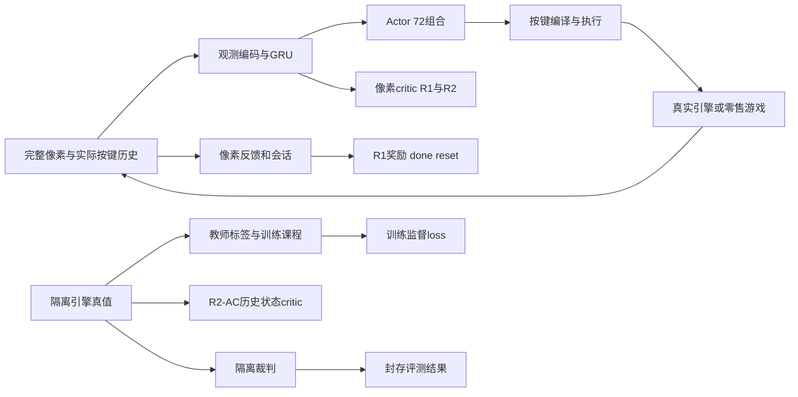

# v4.3.0 开发指南

日期：2026-11-15。规格：`v430-plan-r2`。状态：**设计文档；下述 v430 业务模块与 CLI 尚未实现**。

本指南与 [训练计划](TRAINING_PLAN.md) 配套，规定模块职责、数据契约、PPO/时序语义、开发顺序和验收。参数起点见 [PLAN_SPEC.json](PLAN_SPEC.json)。不得创建只返回PASS的占位接口来满足命令清单。

## 1 当前可复用内容与缺口

| 当前存在的路径 | 可复用的职责 | 使用前须核验 |
| --- | --- | --- |
| `touhou_rl/v400/gym/env.py` | `Th08Env` 的引擎连接/step/reset | 能力声明、游戏数据、实际帧推进、错误处理 |
| `touhou_rl/v400/gym/protocol.py`、`shm.py` | 协议常量/解析、`SharedBlock.pixels()` | 像素新鲜度与同帧证明，不能只凭成功读内存 |
| `touhou_rl/v400/gym/replay_starts.py`、`trajectory.py`、`trajectory_verify.py` | 回放起点、动作序列与复现验证 | takeover支持范围、前缀HASH、真实状态继承 |
| `touhou_rl/v400/teacher/engine.py` | `TeacherEngine`、park/spawn/child_step等训练分支接口 | 实际引擎能力，不假定所有构建均支持 |
| `touhou_rl/v400/teacher/decide.py`、`search.py`、`verify.py` | 碰撞/候选搜索、真实验证 | 视界、动作实际执行、激光/敌人/资源完整性 |
| `touhou_rl/v400/student/obs_spec_v3.py`、`model_v3.py` | 冻结旧观测、空间编码器思路 | 旧digest只读，不能偷换新尺寸后继续加载原模型名 |
| `touhou_rl/v400/rl/env.py`、`policy.py` | 旧RL封装、联合概率/actor-critic参考 | 旧 `policy.py` 使用更早的StudentNet，不是新GRU/72动作实现 |
| `touhou_rl/tactics.py`、`escape/` | 历史战术、时空危险/出口表示 | 旧CollectPower安全门错误；合成结果不转写真机能力 |

当前检出缺 `touhou_rl/v420/`、`configs/v420/`、v420相关脚本/测试及运行资产。W00应从原执行端恢复代码/小证据；资产保持原位核验。找不到旧实现时记录历史复现缺口，新模块可基于已验证v400接口开发，不伪装成旧结果重现。

本版新增业务代码放在独立 `v430` 路径。冻结obs-v3、历史策略、引擎ABI、第三方和原资产不修改。确需改已有公共模块时先给出精确文件与最小原因，纳入工作包白名单后才做。

## 2 模块布局与所有者

```text
touhou_rl/v430/
  contracts.py          # 数据结构、digest、边界校验
  observation.py        # 像素裁剪、历史、真实采集时间
  actions.py            # 72组合分布语义、每帧按键映射
  session.py            # 像素菜单/过面/重开控制
  evaluate.py           # 统一评测入口，隔离结果裁判
  data/                 # manifest、谱系、流式序列加载
  models/               # 多流编码器、GRU、actor与辅助头
  tactics/              # 战术目标、可见线索、区域/道具表示
  teacher/              # 训练专用候选、长程分支、价值/排序标签
  curriculum/           # 训练前缀、课程层级、真实连接
  rl/                   # rollout、GAE、PPO、critic、checkpoint
  feedback/             # 像素事件/资源/终止检测
  deploy/               # Windows抓帧/发键、延迟、会话
  adapt/                # 留出适应与资源公平性
  transfer/             # 第二作框内通用适配
  learn.py              # 表征/BC/微段编排
  sequence.py           # burn-in、序列切分、边界mask
tools/rl/v430.py         # 单CLI，调用上述模块，不堆算法逻辑
configs/v430/           # 运行前物化的真实配置，不含资产/秘密
tests/test_v430_*.py    # 按工作包明确文件名
Document/Update/Alpha/v4.3.0/
  registries/          # 实验、split、身份、最终结算索引
  evidence/Wxx/        # 小证据、逐局表、退出码与引用
.tmp_v430_<run_id>/     # 本机资产，不入Git；全新目录
```

W01负责contracts/actions/session/evaluate公共入口；W02负责observation/tactics及机制数据；W03负责data/models/learn/sequence；W04负责teacher/curriculum/rl；其他目录按 [执行计划](EXECUTION_PLAN.md) 对应包负责。共享CLI和contracts由单个指定执行代理串行整合，避免多个代理同写。

W12新增`settle.py`负责独立证据结算。W00先提供CLI的只读audit子命令，W01再扩展控制入口；不能让W00的验收依赖尚未开始的W01完整实现。

所有实际实现/实验遵守AGENTS.md的DeepSeek Flash执行代理分工。派发包含目标、精确文件白名单、禁止项、完整命令和立即返回要求。主代理独立复核diff、原始记录与退出码。池/Provider不可用时不自动换模型执行长实验；本次仅使用规划例外写文档与复核工具。

## 3 数据流与特权隔离



actor的公开API只接受 `ActorObservation` 和像素产生的记忆，不能接受包含privileged字段的通用dict。R1运行器不导入teacher/state接口；裁判通过单向队列写独立文件，训练进程不能读该目录。权限隔离由运行环境支持时使用，至少要有接口/依赖和哨兵测试。

用同一像素与按键流替换/扰动裁判death、stage、resource、seed，actor logits、R1 reward/done/reset和训练batch选择必须不变。该检查证明软件通路，不证明反馈检测本身准确。

R2-AC的critic可读真值；actor输入不得变化。critic使用detach后的actor历史及独立状态编码器，价值损失不回写actor像素编码器；策略梯度中的优势也detach。R1/R2主比较改用同一像素critic，两者仅反馈/终止通道不同。

## 4 观测契约 ActorObservation

### 4.1 逻辑字段

| 字段 | 类型/初始形状 | 语义 |
| --- | --- | --- |
| `global_rgb` | uint8 `[3,240,320]` | 当前完整框选区域的RGB缩放，含菜单与HUD |
| `play_gray` | uint8 `[4,224,192]` | 当前与前三个真实连续游戏帧的play视图 |
| `hud_gray` | uint8 `[1,448,160]` | TH08原始像素HUD长条；新作定位另验 |
| `executed_key_history` | uint8 `[8,7]` | 从旧到新：left/right/up/down/focus/shoot/bomb实际状态 |
| `history_valid` | bool `[8]` | 冷启动或缺失历史不能伪造为已执行idle |
| `elapsed_capture_s` | float32标量 | 自身采集时钟的间隔；不是引擎内部帧号 |
| `memory` | float32 `[256]` | 模型内部递归状态，不能由教师填充 |

`episode_id`、逻辑帧号、HASH、seed、任务ID、标签和来源信息放在审计record，不进入actor张量。一般部署只有画面和自身操作/采集时钟；课程目标ID若仅用于诊断，单独标 `diagnostic_conditioning`，不能混进正式actor输入。

### 4.2 TH08 O2 的初始编码

源为真实640×480像素，明确通道顺序并测试RGBA→RGB。global对完整框选区域做2×2整数均值；play裁 `(x=32,y=16,w=384,h=448)`，先用BT.601整数灰度 `(77R+151G+28B)>>8`，再2×2整数均值；HUD取原图 `[16:464,480:640]` 的整数灰度，覆盖完整右侧区域。均值均为uint32求和后向下整除4，避免uint8溢出；所有步骤顺序进入obs digest。

归一化在训练minibatch时 `/255.0`；磁盘和rollout保持uint8。固定分辨率下禁止自动插值成另一形状悄悄继续；Windows缩放适配有独立digest。保留alpha/格式错误和短帧检测，不用黑图替补成功样本。

捕获频率需足以得到连续帧；两帧动作不代表可用重复一帧伪造四帧栈。引擎缺帧要重放真实前缀；零售缺帧保留时间信息和invalid标记，按冻结策略处理，不能把旧画面当新状态。若改为稀疏时间栈，必须另起观测版本重新验收。

正式整局reset清空记忆/历史；普通死亡和换面不得读取真值reset隐藏状态，可由像素事件执行预注册更新。恢复课程时从真实可见前缀重放模型记忆，记录checkpoint版本；缓存旧模型hidden不能用于新模型而不核验。

### 4.3 第一个可实现网络候选

下表仅用于O2的开发基线；保留O0/O1对照，不预先断言更大网络有效。卷积记为`输入通道→输出通道/核/步长`，padding为kernel//2，每层GroupNorm(4组)+SiLU。池化保留空间格后flatten与线性投影，避免一开始就把全部位置信息做全局平均。

| 流 | 卷积序列 | 自适应池化与输出 |
| --- | --- | --- |
| global | 3→16/5/2，16→32/3/2，32→32/3/2 | 6×8格，投影128维 |
| play | 4→32/5/2，32→64/3/2，64→64/3/2 | 14×12格，投影128维 |
| HUD | 1→16/3/1，16→32/3/2，32→32/3/2 | 28×10格，投影64维 |
| history | 56按键位+8有效位+1采集间隔 | 65→32线性投影+SiLU |

拼接352维→线性256→LayerNorm→SiLU→单层GRU256→四个线性动作头。卷积/线性均含bias，GRU采用标准两个bias；按此定义actor约2.73M参数，执行时以实际实例统计为准。critic和辅助头单列参数、显存和延迟，不能藏进actor指标。

HUD细字、小弹与目标定位若受池化损伤，先在同数据上检查分辨率/池化与O1的消融；不要仅根据参数量扩网络。辅助头可以保留池化前空间特征，输出的坐标网格、可见性mask及label digest必须绑定具体数据契约。部署若不使用辅助头，导出时剔除并验证动作分布一致。

## 5 动作、会话与有效步长

### 5.1 ActorAction

`move∈[0,8]`，`focus/shoot/bomb∈{0,1}`。方向沿已有MOVES表。联合概率初版为四头概率乘积，log-prob相加，entropy相加。所有72组合都有明确最终掩码；不自动OR SHOOT，否则shoot=0与1会产生同一动作并破坏语义。

action编译器接受当前按键状态和请求，生成逐帧 `executed_masks`；必须记录请求与实际执行。方向冲突只在协议层排除，不能根据真值弹幕/资源给actor mask。游戏中资源不足的bomb请求可实际发送并记录，不用真值过滤。

shoot释放/按下、bomb按下沿与持续按键的实际效果先用真实引擎测试，不假定所有作品一样。必要的边沿逻辑是模型系统一部分；采样与执行用同一状态机，不能评测时额外救援。

### 5.2 会话层

菜单、标题、暂停、过面等待、结局与重开由像素状态机控制，输出带 `controller_source=session` 的按键。控制入口只允许一个owner，actor与session不得同时发键。session不能由engine stage/game_over触发；独立裁判可以记录这些真值。

`controller_source=actor` 的决策才有actor log-prob和policy loss；session动作的actor_loss_mask为0。完整回报链必须保留session期间的结果与时间，不丢掉过面奖励；critic/GAE是否学习该阶段按同一预注册扩展环境语义处理。先用短真实过面回放验证奖励没有因切换owner丢失。

产品若加入额外安全控制器，必须作为公开新系统身份并另测；不可把被真值安全规则覆盖的行为报告成像素actor自主行为。

### 5.3 半马尔可夫步长

常规请求保持2游戏帧，终局可能只推进1帧。引擎开发臂R2-AC的奖励汇总、gamma、GAE依据实际 `elapsed_game_frames`。R1不可把此字段作为额外真值输入：使用自身采集时钟的 `elapsed_control_s`，令 `effective_frames=60*elapsed_control_s`，加速harness使用外部控制器可知的推进节拍。正式R1/R2比较使用同一外部时钟约定；引擎实际帧号仅进隔离裁判。记录 `duration_source`，故障/暂停/掉帧不可伪装成正常两帧。

若动作超时、未送达或被其他owner替换，不能保留原log-prob当有效PPO样本。将受影响片段标invalid，保留证据，按故障策略重新建有效rollout；不能用下一个自动reset后的观测替代本步next_obs。

## 6 训练与数据结构

### 6.1 Manifest

最少字段：`schema, dataset_id, parent_ids, code_snapshot, engine_sha, game_data_manifest_sha, obs_digest, action_digest, label_digest, split_registry_sha, shards, counts, status`。每个shard有相对路径、字节数、SHA、episode/ancestor列表、帧区间、实际决策数、标签有效数、重复情况。

loader拒绝缺shard、SHA不符、schema/digest错配、额外未登记shard及train/dev祖先交叉。状态为partial时只可明确读取已完成、不可变的shard作开发，不能把整个partial数据集判通过。

### 6.2 Transition

```text
record_id, episode_id, ancestor_id, event_id, split
obs_ref, next_obs_ref, history_valid, obs_digest
requested_action, executed_masks, controller_source, action_digest
behavior_policy_sha, behavior_log_prob, recurrent_state_version
reward_components, reward_total, reward_source, reward_digest
terminated, truncated, segment_end, truncation_reason, terminal_observation_ref
elapsed_game_frames, capture_timestamps, delivery_timestamps
actor_loss_mask, value_loss_mask, label_validity, protocol_validity
privileged_ref   # 仅训练/裁判侧可读，actor loader禁止接触
```

`terminated` 是真实任务结束（包括预注册任务期限失败）；`truncated` 是采样/资源中断而任务本身可继续；`segment_end` 只是数据块结束。三者不得共享一个done字段。缺terminal_observation时不能用reset图bootstrap。

### 6.3 BranchOutcome

```text
parent_state_id, prefix_hash, candidate_action_or_plan, execution_trace_ref
continuation_policy_sha, horizon_frames, actual_frames, repeat_id
outcome = alive | death | task_success | task_failure | unknown | invalid
deaths, resources_before_after, power_change, threat_eliminated
enemy_fire_events, progress_events, exit_region, future_reachability_estimate
visibility_status, uncertainty, source, checks
```

所有候选都保留记录，unknown不并入death。有限视界alive不叫长期安全。estimated可达性/敌人归属与引擎真值分字段，不能用近邻发弹归属启发式冒充精确因果。

### 6.4 长序列与存储

frame按episode只存一次，序列引用索引；不把每个4帧栈重复落盘。新O2输入约474kB/决策，四环境×512决策仅观测uint8就约0.97GB，转换float32后约3.88GB，尚未含梯度和网络激活。应按minibatch转float并实测峰值，不能照旧小模型显存估算。

连续全分辨率RGB原帧640×480×3约0.92MB，百万帧未压缩约922GB。禁止默认把所有在线训练帧永久保存。R2持久化完整动作/重建HASH及选择性无损窗口；需要新裁剪时确定性重放。R1/零售不能假设可重放，需冻结抽样证据与必要反馈原帧，且承认未保存部分无法离线重建。

训练rollout可在内存有限缓冲区循环复用；已经登记为资产的磁盘shard/checkpoint不可覆盖或自动清理。达到32GiB停止新增持久资产、先完成账本，不自动删除旧数据换空间。chunk压缩须校验解码前后uint8一致；lossy视频只作观看证据，不作为要求精确重建的训练源。

## 7 记忆、GAE与PPO实现

### 7.1 序列训练

每环境rollout512决策，切为64决策loss段，加前64步burn-in上下文。cold start不足64步时按真实有效mask填充；跨episode不得串接。burn-in更新hidden但不计loss，loss段内做截断反传；padding不得进入优势/熵统计。

同一history在新参数下的精确hidden需要从真实前缀重算。使用采样时stored hidden加有限burn-in是近似，不可宣称逐位等价。实现必须提供exact-prefix参考：在固定真实序列上比较零更新前向、不同chunk边界的输出，以及更新后burn-in近似偏差。若动作/KL差异足以改变开发结果，则增加上下文或用prefix重算，不靠放宽断言掩盖。

从课程起点恢复时hidden由当前checkpoint的像素前缀产生；正式自然整局不由外部强制注入hidden。rollout跨更新继续游戏时记录hidden所属策略版本；参数更新后的首批hidden重建策略要冻结并报告成本。

### 7.2 Return与bootstrap

以两帧为基准，`gamma_t=exp(-effective_frames/(60*tau_s))`，`lambda_t=lambda_base**(effective_frames/2)`；effective_frames的来源严格按§5.3的模式契约。对有效轨迹：

```text
delta_t = r_t + gamma_t * bootstrap_mask_t * V(next_obs_t) - V(obs_t)
A_t = delta_t + gamma_t * lambda_t * continuation_mask_t * A_next
value_target_t = stop_gradient(A_t + V_old(obs_t))
```

真正terminated：bootstrap_mask=0，continuation_mask=0。仅rollout/采样截断：从截断前terminal_observation bootstrap，反向递推不跨另一个episode；实际相邻有效片段按配置可连接。任务期限本身是失败条件时属于terminated；训练预算耗尽不意味着游戏失败。

reward定义若按帧产生，聚合到decision时须与gamma单位一致；不把多帧奖励无条件相加后又当一帧单位。对首死、非末命死亡、game_over、过面、时间截断分别做有可手算答案的短序列验证。

### 7.3 PPO目标

`ratio=exp(logp_current(a_requested)-logp_behavior(a_requested))`，只用于实际按协议执行、actor_loss_mask有效的actor决策。采样温度、动作可用集合、归一化与历史一致。actor loss为标准clipped surrogate减熵，加独立BC/辅助loss；critic loss独立计算。优势按有效actor样本整体标准化，std有epsilon，记录标准化前统计。

每轮4个epoch，8×64有效loss步的序列minibatch；所有样本来自本轮固定behavior policy。演示/DAgger数据只进独立监督项，不能混入on-policy ratio。更新后的KL在同采样分布上测；mean KL超过0.02停止本次epoch并报告，不能只计算T=8的KL后声称T=1部署漂移很小。

BatchNorm运行统计若存在需冻结并审计；新架构优先使用不依赖batch运行均值的归一化。训练/评测dropout等随机层必须有明确行为。固定输入、相同权重、零更新的log-prob重算误差和ratio偏差≤1e-5作为初始数值门。

### 7.4 价值预热与辅助目标

独立critic先拟合真实returns，最多1000更新。actor参数/编码器/归一化状态须保持一致，固定输入logits最大差≤1e-6。不得只冻结最后一个policy head却让共享trunk被critic更新。

各辅助loss按自身有效标签数归一，缺标签的batch不产生该loss；默认权重是开发参数，不是门。记录各项梯度范数和方向冲突。像素价值估计不佳时可用R2-AC诊断，正式R1/R2仍匹配像素critic。

## 8 战术与资源模块的实现要求

战术模块只产生候选目标/辅助预测，第一版不能在actor之后偷偷覆盖动作。若显式规则参与最终动作，其控制权限、执行概率和评测身份必须公开；旧模型+规则不可冒称纯学生收益。

威胁预测同时表达已发弹和可能发射的区域，考虑候选玩家路径改变敌人瞄准。训练教师可用真实分支比较，部署只用像素预测。长期危险不确定时保留多种覆盖假设；把全扇形粗掩码作为保守候选，不禁止所有精细穿缝方案。

P收集候选需要 `approach_path, pickup_window, exit_path, predicted_threat, power_benefit, uncertainty`。完整检查替代动作自身，不能拿pilot右移的安全余量证明上移安全。满火力、无可见P、到达前离屏、出口被封、资源读数unknown均有明确分支；unknown不能自动补“满火力/零火力”。

敌人抢杀候选比较kill/fire/arrival时间的分布及风险，不能只用最近敌人。Boss输出考虑碰撞体、可见阶段、有效射线与后续位置，不以贴近Boss为单独奖励。复活课程使用自然复活后的状态与资源，禁止reset补满。

## 9 像素反馈、零售与迁移

反馈接口返回事件后验、资源后验、时间锚点和unknown；会话状态为 `playing / hit_pending / respawn / transition / game_over / menu / ending / unknown` 或等价实现。原始预测与平滑结果同时留存，资源跳变不能用真值矫正。

检测器训练/开发/确认按完整连续流及祖先隔离。评测事件级P/R、延迟和长流误报，不能让大量静止HUD帧压低总体误差。R1 reward/done/reset全部来自该模块和预注册通用截断。

Windows记录capture开始/结束、内容新鲜度、推理、排队、发键和可观察生效时间。P95≤33.3ms不等于输入真实低延迟，必须报告采集到可观察动作生效的端到端测量及误差。不能暂停游戏等推理来伪装60Hz。

第二作用框内归一化全图和通用视觉定位；TH08固定HUD坐标只属于训练脚手架。STRICT运行不得调用目标内存/教师/标签，也不得由人工看真值选checkpoint。ASSISTED使用独立run/结果表，不混淆门。

实现O-G独立观测契约：框选全图保持纵横比缩放并居中补边至320×240，产生RGB与连续4帧灰度视图；resize算法、padding值和源尺寸进入digest。移除固定HUD支路，global/play/history投影拼接为288维再映射GRU256。先在合法干净源任务上训练并测闭环，不把改形状后的O2称为原checkpoint。目标反馈模型读取原始全画面，固定裁剪/人工目标标签均不允许；任何通用定位器也要经谱系审计。缩放补边是确定性预处理，不能用补边掩盖捕获失败。

## 10 CLI与配置

以下命令均为**待实现接口**。实现前只能执行本文最后的文档复核器。CLI默认拒绝已有输出目录、未冻结配置、未通过前置、空数据和不匹配digest；禁止静默退回mock/随机模型。

配置公共字段：`schema, experiment_id, phase, mode, frozen_at, spec_revision, identities, roots, split_registry, obs, actions, model, learner, reward, curriculum, evaluation, budget, recovery`。roots显式给出引擎/游戏数据/资产路径；密钥/个人路径不写共享示例。正式确认还必须给 `candidate_manifest_sha`、新批次登记和完整分母。

```powershell
# 在已恢复源码的仓库根运行。涉及Linux引擎时在资产主机运行同一源码/配置。
$env:PYTHONPATH='D:\WorkShop\Touhou_RL'
python tools/rl/v430.py audit --config configs/v430/assets.json --out Document/Update/Alpha/v4.3.0/evidence/W00/audit-001.json
python tools/rl/v430.py validate-contract --config configs/v430/contracts.json --out Document/Update/Alpha/v4.3.0/evidence/W01/contract-001.json
python tools/rl/v430.py validate-splits --config configs/v430/splits.json --out Document/Update/Alpha/v4.3.0/evidence/W09/splits-001.json
python tools/rl/v430.py tactical-pilot --config configs/v430/tactical_pilot.json --out .tmp_v430_tactical_001
python tools/rl/v430.py power-pilot --config configs/v430/power_pilot.json --out .tmp_v430_power_001
python tools/rl/v430.py prepare-data --config configs/v430/bootstrap.json --out .tmp_v430_bootstrap_001
python tools/rl/v430.py pretrain --config configs/v430/perception.json --out .tmp_v430_perception_001
python tools/rl/v430.py behavior-clone --config configs/v430/bc.json --out .tmp_v430_bc_001
python tools/rl/v430.py micro-learn --config configs/v430/micro.json --out .tmp_v430_micro_001
python tools/rl/v430.py train --config configs/v430/s1.json --out .tmp_v430_s1_001
python tools/rl/v430.py evaluate --config configs/v430/s1-dev.json --out .tmp_v430_s1_dev_001
python tools/rl/v430.py confirm --config configs/v430/s1-confirm.json --out .tmp_v430_s1_confirm_001
python tools/rl/v430.py windows-eval --config configs/v430/windows.json --out .tmp_v430_windows_001
python tools/rl/v430.py feedback-eval --config configs/v430/feedback.json --out .tmp_v430_feedback_001
python tools/rl/v430.py train --config configs/v430/pixel_improvement.json --out .tmp_v430_pixel_001
python tools/rl/v430.py train --config configs/v430/fullrun.json --out .tmp_v430_fullrun_001
python tools/rl/v430.py confirm --config configs/v430/fullrun-confirm.json --out .tmp_v430_fullrun_confirm_001
python tools/rl/v430.py adapt --config configs/v430/adapt.json --out .tmp_v430_adapt_001
python tools/rl/v430.py adapt --config configs/v430/transfer.json --out .tmp_v430_transfer_001
python tools/rl/v430.py settle --registry Document/Update/Alpha/v4.3.0/registries/runs.json --out Document/Update/Alpha/v4.3.0/evidence/W12/settlement-001.json
```

配置路径仅定义接口/交接目标，当前不创建伪运行配置；执行代理须填写真实身份并冻结。为方便派发，`plan --config ...` 可以打印依赖和预算，但不能启动实验；`--dry-run`只做参数/资产检查，结果永远标非能力。

退出码统一：0请求任务按协议完成/请求门通过；2输入/协议/环境invalid；3有效测量未达请求门；4资源或中断导致不完整；其余非零为程序错误。训练命令exit0不代表capability_gate通过。结果JSON分开 `execution_status / protocol_validity / research_result / capability_gate`。

## 11 测试矩阵与开发次序

每个实现包先做最小可验收切片；测试文件是未来交付项，不声称当前存在。

| 包 | 精确测试文件 | 必验行为 |
| --- | --- | --- |
| W01 | `tests/test_v430_contracts.py`、`test_v430_actions.py`、`test_v430_session.py` | 72组合映射、shoot释放/owner、HASH/时间、正负对照、普通死亡与末命、空结果拒绝 |
| W02 | `tests/test_v430_observation.py`、`test_v430_tactics.py`、`test_v430_power.py` | HUD覆盖、无真值入actor、动态威胁、候选自身往返路径、未知道具 |
| W03 | `tests/test_v430_data.py`、`test_v430_sequence.py`、`test_v430_models.py` | 谱系、SHA、额外shard、部分标签mask、序列边界、checkpoint形状 |
| W04 | `tests/test_v430_ppo.py`、`test_v430_curriculum.py`、`test_v430_teacher.py` | 零更新ratio、GAE终止/截断、actor冻结、teacher续行、资源/hidden自然继承 |
| W05/W08 | `tests/test_v430_feedback.py`、`test_v430_privilege.py` | 延迟/重复事件/unknown、R1裁判扰动不变、封存日志隔离 |
| W06 | `tests/test_v430_deploy.py` | 陈旧截图、丢帧、按键属主、异常释放、时间统计 |
| W09 | `tests/test_v430_splits.py` | 全系统祖先交叉、反馈/选模污染、sealed保护、O-G源任务身份 |
| W07/W10/W11 | `tests/test_v430_fullrun.py`、`test_v430_adapt.py`、`test_v430_transfer.py` | 不续关/不补资源、任务谱系、同预算、STRICT/ASSISTED隔离 |
| W12 | `tests/test_v430_settle.py` | 逐局重算、分母/身份、invalid不PASS、缺腿不complete |

W01完整验收命令示例：

```powershell
$env:PYTHONPATH='D:\WorkShop\Touhou_RL'
python -m pytest -p no:cacheprovider --basetemp .tmp_v430_pytest_w01 -q tests/test_v430_contracts.py tests/test_v430_actions.py tests/test_v430_session.py
python tools/rl/v430.py validate-contract --config configs/v430/contracts.json --out Document/Update/Alpha/v4.3.0/evidence/W01/contract-001.json
```

W02必须再跑真实TACT/POWER，W03必须跑micro-learn，W04必须有实际训练/开发结果；测试总数和compileall都不能替代游戏证据。其他包按表中完整路径组成各自验收命令，派发时不得写“跑相关测试”这种模糊交接。

推荐实现顺序：contracts/actor与真值分离 → 统一动作/会话/评测 → 观测与数据索引 → teacher机制/POWER → 序列与模型 → BC微段 → PPO课程 → 正式部署 → 像素自我改进/多面 → 干净适应。W05/W06/W09在可用接口形成后并行。

## 12 运行、故障恢复与资产

每run建不可覆盖目录，记录pid/进程组/属主/超时；只清理自身明确启动的进程，不能按名字杀全机引擎。长标注每5个事件、训练每个预注册切片落不可变完成索引；不要只保留一个会被反复覆盖的partial.json。

checkpoint含模型/优化器/RNG、参数表SHA、计数器、观测/动作/回报digest、数据谱系和运行父节点。写新临时文件后原子发布为新的不可变checkpoint；不得覆盖既有检查点。恢复采用新的子run，明示checkpoint和起点来源；不能恢复完整引擎时重新开始episode并记中断成本。

达到任一资源80%时不新增长任务，预留保存/结算空间；原始数据不可删。新增资产由单独manifest步骤更新ASSET_SYNC.md与sha256，不把state/journal的活文件漂移当静态资产损坏，也不任意重钉真正不匹配的静态文件。

远端只同步代码/配置/测试/Document小证据。没有引擎/数据的机器只跑不依赖资产的测试，并明确not_run的真实腿。禁止下载假资产、把运行目录塞进PR，或恢复旧暂停采集来凑新计划数据。

## 13 验收与交付清单

一次开发交付必须能回答：改了哪些文件；为什么在白名单内；实际执行哪些命令与退出码；真实/合成/跳过分别多少；哪个数据/模型身份；原始逐条记录在哪里；哪个门通过以及范围；哪些未做；下一步依赖什么。

最终模型卡包含部署输入、全部控制组件、硬件/延迟、训练特权、数据谱系、全训练seed结果、完整门表、真实视频索引、失败模式、目标作品/路线及复现命令。训练代码、评测器和裁决脚本进入可同步源码；checkpoint仍留本机按资产清单管理。

新能力声明必须指向原G410完整门；G430工程门、文档校验、演示录像、micro成功都不能单独宣布总目标完成。

## 14 本次文档的真实复核入口

下列两个脚本已经存在，只核对历史证据与计划文档，不启动游戏。其余v430业务命令全部待实现。

```powershell
$env:PYTHONPATH='D:\WorkShop\Touhou_RL'
python Document/Update/Alpha/v4.3.0/evidence/verify_review.py
python Document/Update/Alpha/v4.3.0/evidence/verify_plan.py
```

新计划检查报告首次创建使用 `verify_plan.py --write`；已有报告拒绝覆盖。检查参数一致、阶段/策略覆盖、预算算术、链接/格式与历史源SHA，不把文档检查数计为模型测试数。
