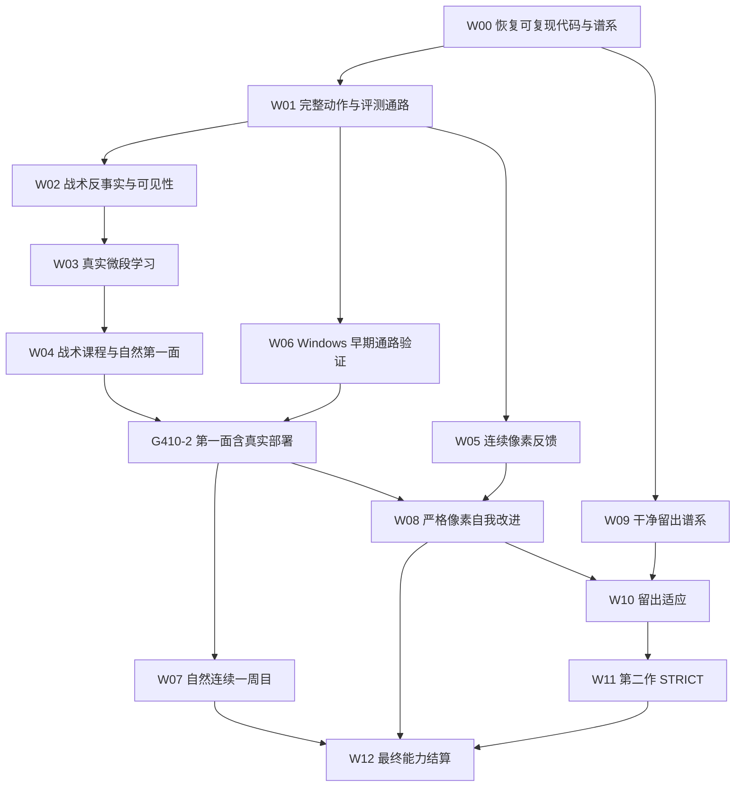

# v4.3.0 工作包与验收交接

日期：2026-11-15。状态：**规划交付；实施未启动**。业务修改、采集、训练、原状态写入均未执行。本文明确的未来命令是待实现接口，不能当已有工具直接报告成功。

完整训练语义见[训练计划](TRAINING_PLAN.md)，模块/数据/算法契约见[开发指南](DEVELOPMENT_GUIDE.md)，参数见[PLAN_SPEC](PLAN_SPEC.json)。本文负责包的权限、依赖与交接，不单独维护另一套训练参数。

## 1 工作依赖



每包由符合 AGENTS.md 的 DeepSeek Flash 执行代理落地，主代理负责范围、证据与结论复核。当前会话没有该 Provider，不能把本次规划当作已派发实施。未来只恢复本版明确工作，不自动恢复暂停的 WP05。

## 2 工作包清单

以下为每包**允许新增或修改范围**；共享前置代码需要先列出精确文件再加入该包白名单。所有包共同禁止修改旧证据/账本、协议 ABI、引擎/第三方、既有资产；禁止删除、提交、上传。资产新增时由专门清单任务同步 ASSET_SYNC 两份文件，不覆盖旧条目。

新观测/动作版本通过独立模块与原引擎既有按键接口实现，不改冻结 obs-v3 或引擎 ABI。`tools/rl/v430.py` 由W00建立只读audit入口，W01扩展公共控制入口；各包可按自身新子命令修改该文件，必须指定同一负责代理串行整合。表中的 `actions.py`、`session.py` 等缩写均相对 `touhou_rl/v430/`；包内必要的`__init__.py`随该包授权，根包由W01负责。新测试仅限开发指南§11与PLAN_SPEC明确列出的本包文件。

| 包 | 产出与先决条件 | 文件白名单 | 验收与失败后动作 |
| --- | --- | --- | --- |
| W00 | 恢复执行端 v420 原源码/配置/测试、脚本身份；登记可用资产、旧在途状态与干净谱系；先不运行实验 | 新恢复的 `touhou_rl/v420/`、`tools/rl/v420*.py`、`configs/v420/`、`tests/test_v420*.py`；`tools/rl/v430.py`的audit入口、`configs/v430/assets.json`；`Document/Update/Alpha/v4.3.0/evidence/W00/` | SHA 与报告一致或逐项解释差异；全新进程可加载原模型。缺原文件就报告缺口，不能自行制造兼容替身 |
| W01 | 同一控制入口的成功/失败回放、发射释放、bomb、正常残机、像素转场与时间契约 | `touhou_rl/v430/contracts.py`、`actions.py`、`session.py`、`evaluate.py`；`tools/rl/v430.py`；`configs/v430/contracts.json`；相应新测试及 W01 证据 | 至少 3 个真实成功/失败来源各重放 2 次，裁判与输入一致；相关冷启动/换面/终局边界无未解释差异。新观测每类样本验证而非沿用 G420-0 |
| W02 | [TACT-01](TACTICAL_LEARNING.md)、POWER-01与输入可见性审计；TACT-30与POWER-30各至少10祖先 | `touhou_rl/v430/tactics/`、`observation.py`；`configs/v430/tactical_pilot.json`、`power_pilot.json`；相应新测试及 W02 证据 | 两种威胁机制各至少5个不同祖先成功见证，含扇形撤离；POWER覆盖五种行为及候选自身路径。失败则修战术生成或可见性，暂不扩标 |
| W03 | 数据索引、表征预训练、BC；10个真实训练微段的D-state/D-pixel/D-pixel-memory诊断，另30留出事件 | `touhou_rl/v430/data/`、`models/`、`learn.py`、`sequence.py`；`configs/v430/bootstrap.json`、`perception.json`、`bc.json`、`micro.json`；新测试及 W03 证据 | 固定片段≥9/10；3seed留出比较；区分“拟合”“泛化”“条件不足”。未会片段就不启动大规模课程 |
| W04 | 递归PPO/R2-AC特权critic、优势监督、学生分布聚合、后缀→整面课程 | `touhou_rl/v430/rl/`、`curriculum/`、`teacher/`；`configs/v430/s1.json`、`s1-dev.json`、`s1-confirm.json`；新测试及 W04 证据 | 逐层开发≥80%且至少2/3 seed同方向；记录自然帧占比。候选自然 S1N dev≥10/20才提名正式100局，不用课程成功充数 |
| W05 | 完整连续流像素事件、资源、终局、重开 | `touhou_rl/v430/feedback/`；`configs/v430/feedback.json`；新测试及 W05 证据 | G410-3 原完整门。不能放宽到单帧准确率；不足项留在本包，不阻塞 R2 的工程诊断 |
| W06 | 早期 Windows 时延/输入冒烟；后期冻结候选真实确认 | `touhou_rl/v430/deploy/`；`configs/v430/windows.json`；新测试及 W06 证据 | 真实60Hz、观测到动作 P95≤33.3ms、迟到<1%初始工程门；正式至少20会话保留harness点估计70%，区间与全部失败齐全 |
| W07 | 多面教师战术改进、资源继承、同一策略自然一周目 | `touhou_rl/v430/curriculum/`、`teacher/`；`configs/v430/fullrun.json`、`fullrun-confirm.json`；新测试及 W07 证据 | 原G410-1适用多面腿、G410-5；逐面练习不拼接。优先补最早失败面/跨面转场 |
| W08 | R0/R1/R2 同初始化同预算；像素运行闭环无真值依赖 | `touhou_rl/v430/rl/`、`feedback/`；`configs/v430/pixel_improvement.json`；新测试及 W08 证据 | G410-4；≥3训练seed，原提升与区间门。R1运行时critic/课程/reset也不得接真值 |
| W09 | 两个干净任务家族、全系统预训练谱系与O-G源任务；与W00开始并行 | `touhou_rl/v430/data/lineage.py`、`tests/test_v430_splits.py`；`Document/Update/Alpha/v4.3.0/registries/`、`configs/v430/splits.json` | validate-splits通过且原始身份可核验；无策略/感知/奖励/选模污染；不读取sealed结果，已污染模型只作开发 |
| W10 | Z/A/S/A-ad 同预算留出适应，独立固定时点评测 | `touhou_rl/v430/adapt/`；`configs/v430/adapt.json`；新测试及 W10 证据 | G410-6：两个家族AULC、最终非劣、Holm；不能仅靠换seed制造新任务 |
| W11 | 第二作合法资源、像素框选、反馈、适应和自然结局 | `touhou_rl/v430/transfer/`；`configs/v430/transfer.json`；新测试及 W11 证据 | G410-7 STRICT；辅助标注开独立ASSISTED。资源缺失时仍可推进其他包，但不宣称迁移成立 |
| W12 | 证据结算、模型卡、命令、全门表与可运行交接 | `touhou_rl/v430/settle.py`、`tests/test_v430_settle.py`；`Document/Update/Alpha/v4.3.0/`新文件；必要清单任务仅 `ASSET_SYNC.md`、`ASSET_SYNC.sha256` | 完整证据真实通过才结总目标；所有未测/负结果与运行限制一起交付；证据不覆盖 |

W04 的开发候选条件只是正式测量的筛选开关，不能推断正式 50/100 必过。若通过有能力的另一条方法得到候选，工程研究门可报告该方法的适用分支，不能因没走某个指定算法拒绝真实能力；原 G410 的必要门仍须完整结算。

## 3 第一批任务必须足够小

1. **恢复可执行身份。** 逐文件查原 v420 实现和报告 SHA，不运行训练。同步只涉及源代码/配置/小证据；原资产保留原位。W00 报告应说明当前编辑端与资产端各自可运行什么。
2. **通过同一入口重放一次成功和一次失败。** 验证 SHOOT 释放、终局、输入历史和 reset。形成最小真实通路证据后再扩到 W01 全部边界。
3. **建立 10 个具体失败案例。** 先看 3 个扇形、3 个抢杀、2 个诱导、2 个恢复案例，逐个回溯较早决策点；这些是开发切片，后来可并入 W02 训练池，不作独立确认。
4. **使一个真实战术片段被像素策略反复学会。** 验证第一次完整操作→反馈→更新→再次执行的因果闭环，再扩为 10 个训练片段。
5. 同时推进 W05 数据/事件定义、W06 Windows 小通路、W09 干净谱系；不等待大规模反事实扩容。

旧 v420 扩容如果原主机确仍在运行，先只读查进程属主、完成索引与退出码；不能根据本仓库旧 PID 假定存活，也不能杀掉不属于本次任务的进程。任何接管应形成新运行记录，不回写旧暂停快照。

## 4 未来 CLI 的明确契约

**本节接口尚不存在，须由对应工作包实现后才能运行。** 未提供假配置或占位 PASS。所有运行输出到全新路径；对已有输出目录默认拒绝覆盖。

```powershell
# 从仓库根运行；实现后分别用于 W00 / W01 / W02 / W03
$env:PYTHONPATH='D:\WorkShop\Touhou_RL'
python tools/rl/v430.py audit --config configs/v430/assets.json --out Document/Update/Alpha/v4.3.0/evidence/W00/audit-001.json
python tools/rl/v430.py validate-contract --config configs/v430/contracts.json --out Document/Update/Alpha/v4.3.0/evidence/W01/contract-001.json
python tools/rl/v430.py validate-splits --config configs/v430/splits.json --out Document/Update/Alpha/v4.3.0/evidence/W09/splits-001.json
python tools/rl/v430.py tactical-pilot --config configs/v430/tactical_pilot.json --out .tmp_v430_tactical_001
python tools/rl/v430.py power-pilot --config configs/v430/power_pilot.json --out .tmp_v430_power_001
python tools/rl/v430.py prepare-data --config configs/v430/bootstrap.json --out .tmp_v430_bootstrap_001
python tools/rl/v430.py pretrain --config configs/v430/perception.json --out .tmp_v430_perception_001
python tools/rl/v430.py behavior-clone --config configs/v430/bc.json --out .tmp_v430_bc_001
python tools/rl/v430.py micro-learn --config configs/v430/micro.json --out .tmp_v430_micro_001

# W04 / W05 / W06；confirm 只有候选冻结与谱系审计通过后才允许
python tools/rl/v430.py train --config configs/v430/s1.json --out .tmp_v430_s1_001
python tools/rl/v430.py evaluate --config configs/v430/s1-dev.json --out .tmp_v430_s1_dev_001
python tools/rl/v430.py confirm --config configs/v430/s1-confirm.json --out .tmp_v430_s1_confirm_001
python tools/rl/v430.py feedback-eval --config configs/v430/feedback.json --out .tmp_v430_feedback_001
python tools/rl/v430.py windows-eval --config configs/v430/windows.json --out .tmp_v430_windows_001

# W07 / W08 / W10 / W11 / W12
python tools/rl/v430.py train --config configs/v430/fullrun.json --out .tmp_v430_fullrun_001
python tools/rl/v430.py confirm --config configs/v430/fullrun-confirm.json --out .tmp_v430_fullrun_confirm_001
python tools/rl/v430.py train --config configs/v430/pixel_improvement.json --out .tmp_v430_pixel_001
python tools/rl/v430.py adapt --config configs/v430/adapt.json --out .tmp_v430_adapt_001
python tools/rl/v430.py adapt --config configs/v430/transfer.json --out .tmp_v430_transfer_001
python tools/rl/v430.py settle --registry Document/Update/Alpha/v4.3.0/registries/runs.json --out Document/Update/Alpha/v4.3.0/evidence/W12/settlement-001.json
```

W00 还须定义 `assets.json` 的本机显式路径，不硬编码某执行机的 WSL 绝对路径。确需 Linux 引擎的子命令在资产主机运行同一源码/配置，路径通过配置绑定；Windows 端不能以“命令存在”假称引擎已启动。

所有结果 JSON 至少含：schema、experiment_id、身份 SHA、开始/结束时间、完整 argv、exit_code、protocol_validity、原始记录索引、统计分母、run/seed/祖先数、各项资源、remaining_gaps。核心裁决器输入逐局文件/哈希，不接收手抄 `--mean` 或 `--clears` 作为权威数据。

退出码：0 表示该命令实际请求的检查/门满足；2 表示输入/环境/协议无效；3 表示有效测量未达请求的门；4 表示资源限额导致不完整；其他非零为程序错误。训练命令的 0 只说明该训练任务按协议结束，`capability_pass` 仍由独立裁决产生。skip、空数据、部分输出不得返回门通过。

## 5 测试边界与派发模板

文档变更不需跑整个业务测试。实现后的测试必须针对行为：真实按键与旧/新历史一致、成功/失败控制、递归边界、PPO ratio 与截断 bootstrap、actor 特权通路隔离、裁判拒绝缺失/污染输入、像素会话重开。合成单测只验证实现，不充当游戏证据。

每包运行其明确测试文件。例如 W01 的完整验收命令（测试文件也是待实现产物）：

```powershell
$env:PYTHONPATH='D:\WorkShop\Touhou_RL'
python -m pytest -p no:cacheprovider --basetemp .tmp_v430_pytest_w01 -q tests/test_v430_contracts.py tests/test_v430_actions.py tests/test_v430_session.py
python tools/rl/v430.py validate-contract --config configs/v430/contracts.json --out Document/Update/Alpha/v4.3.0/evidence/W01/contract-001.json
```

后续包同样提供**明确测试文件列表**及自身真实实验命令；不能只用 compileall 或测试总数验收能力。

派发示例：

```text
请使用 Provider=DeepSeek、模型=DeepSeek v4.1 flash。
任务：完成 W01 的真实成功/失败控制通路和时间动作边界验证。
允许修改：仅 W01 表中白名单；若需要改已有模块，先返回精确文件和理由。
禁止：不改协议/ABI/依赖/第三方；不删、不提交、不上传；不改旧状态、证据或资产；不恢复 WP05。
验收命令：执行本文件 §5 的两条完整命令，记录各自退出码；相关引擎命令须在已核验资产主机运行。
只返回：完成/未完成、变更文件、真实与合成检查分别统计、命令和退出码、证据路径、剩余阻塞。
完成或遇到阻塞立即返回；长任务按可验收切片汇报，不长时间静默。
```

主代理验收须独立检查 diff 白名单、命令是否实际运行、统计与逐条记录是否一致；不能只转述执行代理结论。并发不超过 3–4 个代理，重引擎/GPU 任务服从共享资源排程。

## 6 数据与统计

冻结注册表，保留 60000–60199 禁训以及 61000–61099、61400–61499 等旧保护范围；确认新范围是否已暴露只能查登记，不运行其中轨迹探看。历史 1000–1039 已作开发，不能称全新确认。第二作不可控 RNG 时使用真实独立会话和明确分组，不伪造种子配对。

比较单位：训练 seed → 祖先任务/episode → 事件。帧是相关观测，不能当独立样本。方法结论至少 3 个训练 seed并报告每个结果；3 seed区间仍可能很宽，此时为证据不足。部署单 checkpoint 的确认与方法稳定性结论分开。

G410-4 的方法确认建议每个训练 seed 各 100 个新任务进行 R0/R1/R2 配对，层级分析先保留训练 seed 这一层，不能把合计 300 局当 300 个独立训练。新确认任务数、共用任务的相关性、候选选择和所需功效在开跑前冻结；该档成本另列。

数据扩容使用固定留出、嵌套训练子集；数据量、训练曝光、模型容量、目标、观测逐项控制。提前冻结主指标和最大候选数；频繁查看的开发结果只供筛选，不用于最终显著性。正式确认失败后不得在同批上改模型再宣称新的独立确认。

游戏失败、超时、崩溃保留在已预注册分母；技术协议失效时整批标 invalid，修复后使用新的完整批次，不能逐个删掉难局。所有中断保留实际已用资源，不能重新开始就重置账本。

## 7 新工程门与旧能力门的映射

| 新门 | 范围与通过条件 | 后续能力门 |
| --- | --- | --- |
| G430-E0 | W00 身份与可复现源码；W01 完整动作、正负结果、时间/边界实际通过 | 支持 G410-0；不自动追认所有数据/保真范围 |
| G430-T | W02 的可重复战术见证与可见线索，W03 的真实微段≥9/10及留出三seed结果 | 研究门；不是 G410-2 |
| G430-C | W04 的课程层级、真实连接、自然起点成绩与候选冻结 | 进入 G410-2 正式确认 |
| G430-P | W05 的像素反馈与隔离、W08 的严格训练通路 | G410-3/4 的全部原门 |
| G430-D | W06 的真实时序与全流程运行 | G410-2/5/7 的 Windows 腿 |
| G430-X | W09 谱系、W10/W11 的干净任务与真实资源核验 | G410-6/7 |

当前所有 G430 门均 not_run。原 `state.json` 的 active/paused 是原工作流的历史状态，本次没有修改或替它们恢复。不要把“路线设计完成”写成“最终能力完成”。

## 8 本次文档审查的可运行复核

下列入口是本次新增且实际运行的**只读证据复核器**，不启动游戏、不训练、不改历史文件；它不同于 §4 的未来 CLI。

```powershell
$env:PYTHONPATH='D:\WorkShop\Touhou_RL'
python Document/Update/Alpha/v4.3.0/evidence/verify_review.py
```

首次生成独立审查记录时使用 `--write`，只允许创建不存在的 `review_checks.json`；已有文件默认拒绝覆盖。普通运行只在 stdout 输出复核结果。验证对象为源 JSON 的统计、当前文件存在性、文档相对链接与本次范围；不运行历史声称的 469 个测试。
